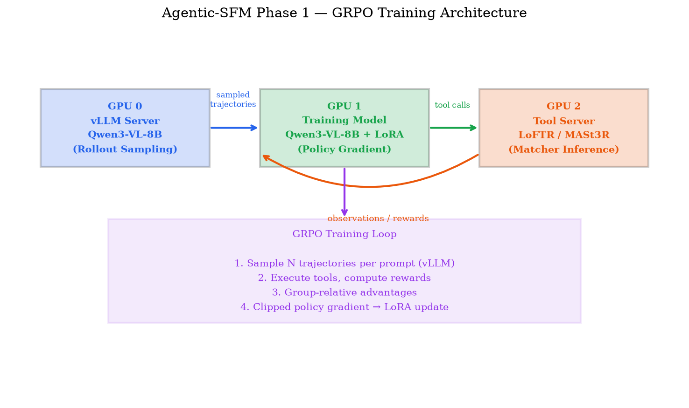
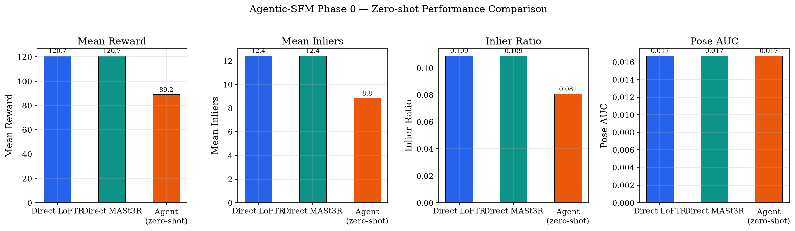
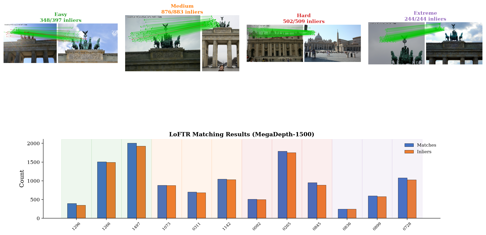
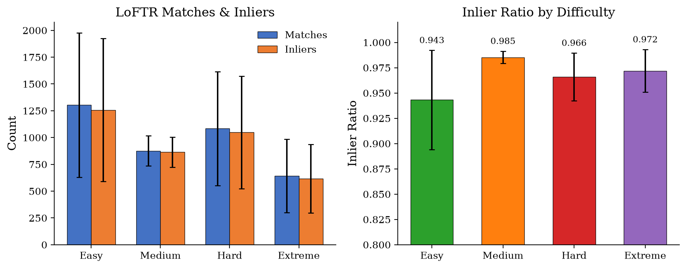
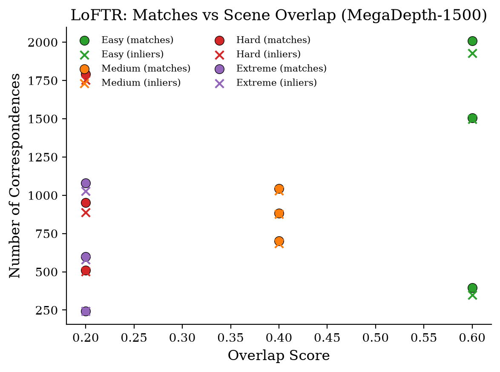
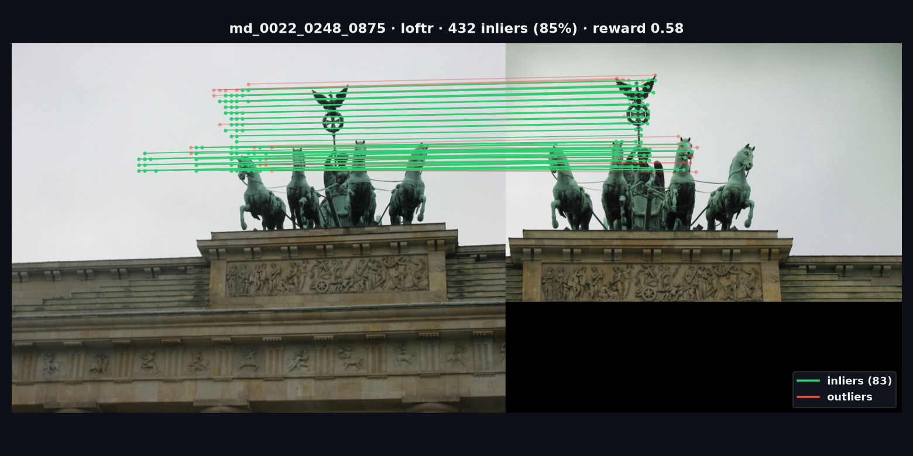
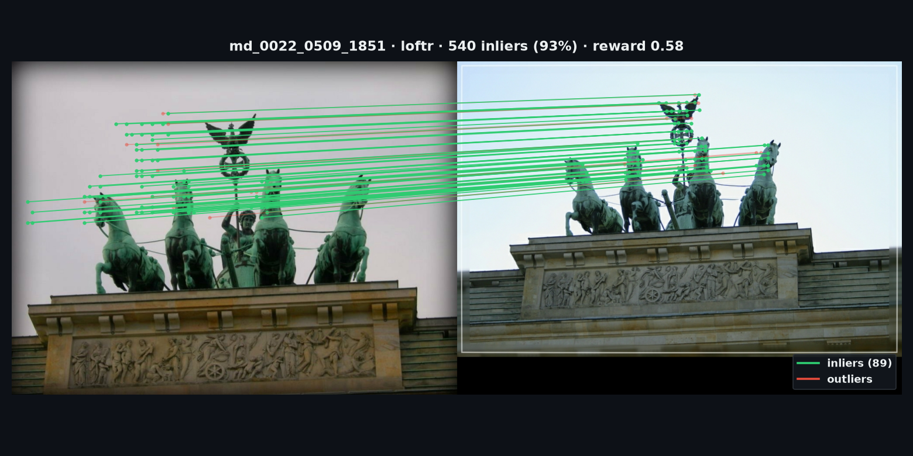
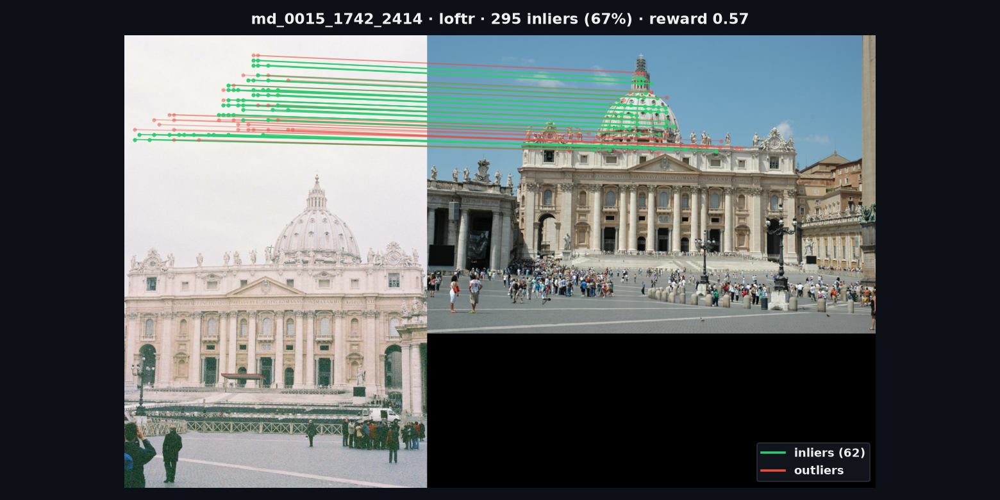
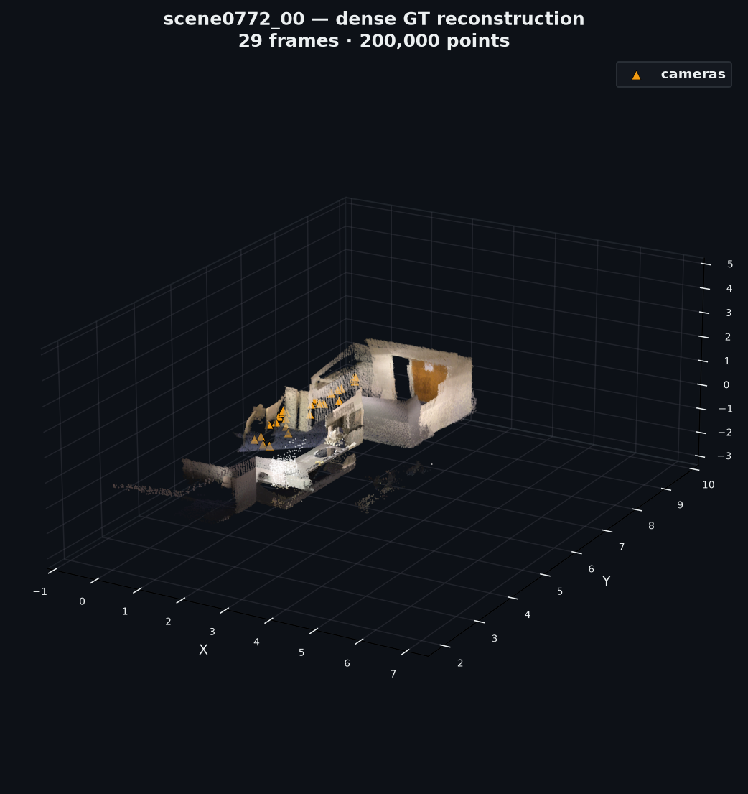
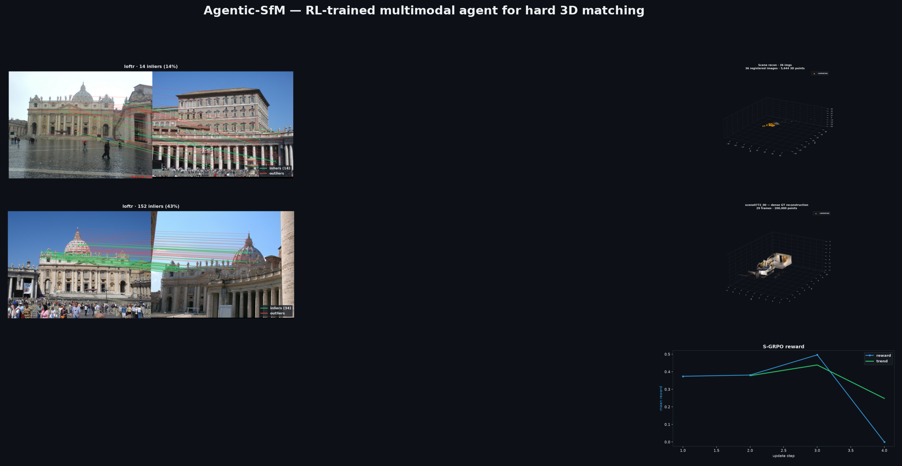

# Agentic SfM

**RL-trained multimodal agents for hard 3D reconstruction.**

## Summary

Agentic SfM asks whether a small vision-language model (Qwen3.5-2B) can learn to orchestrate geometric tools (crop, match, doppelganger check, sparse reconstruction) so that structure-from-motion succeeds where a fixed matcher fails. The reward is computed from ground-truth poses, not from human labels. The central question is whether learned tool orchestration improves reconstruction over simple, equally budgeted baselines.

**Current status: negative.** The pair-level RL agent does not beat plain LoFTR matching on the hard validation set (success 62% vs 88%). The scene-level agent has not been compared against valid baselines, and the evaluation used to report it has known protocol defects (Section "Known problems"). A pose-prior study (a feed-forward pose model exposed as a matcher backend) is implemented, but its benchmark job is queued and has not run, so it has no results yet. No claim in this repository should be read as the agent outperforming a baseline.

## Status at a glance

| Phase | Status | What it shows | Evidence |
|---|---|---|---|
| 0. Zero-shot cropping | Done | Stock model cropping does not beat direct matching. Negative result. | `results/README.md`, `results/phase0/comparison.json` |
| Pair-level SFT | Done | Warm-start adapter that emits valid tool-call JSON. | `outputs/sft/`, `outputs/phase1_hard/warmstart/` |
| 1. Pair-level GRPO (hard pairs) | Stopped at about step 200 (2-day time limit). Best checkpoint evaluated. Worse than LoFTR. | Success 62% vs LoFTR 88% on hard val (n=50). | `outputs/eval_pair/phase1_hard_best_8019429.json` |
| 2. Scene-level GRPO | Training finished (50 epochs). Evaluation on 10 scenes, protocol invalid as a benchmark. | Success 30%, but two of ten scenes were training scenes and the baselines are not comparable. | `outputs/phase2/run_8073061/`, `outputs/scene_eval/run_8085187/scene_eval_results.json`, `docs/scene_eval_and_env_proposal.md` |
| Pose-prior study | Implemented and unit-tested. Benchmark job 8213282 is RUNNING (started 2026-10-10 21:05 on gpu022). No results yet. | Nothing measured yet. | `src/agentic_sfm/pose_prior.py`, `jobs/bench_pose_priors.slurm`, `data/frozen_eval_manifest.json` |
| Held-out evaluation | Manifest frozen (30 ScanNet scenes). Evaluation not run. | Nothing measured yet. | `data/frozen_eval_manifest.json`, `docs/scene_eval_and_env_proposal.md` |

## Motivation and core question

Structure-from-motion pipelines fail on hard pairs: low overlap, large viewpoint change, repeated texture, and doppelganger (near-identical, non-overlapping) views. A fixed matcher cannot change its strategy per pair. We treat the problem as a multi-turn decision: the policy chooses when to crop, which matcher to call, and when to stop. Training uses GRPO with a reward computed from ground-truth poses.

The core question has two parts. First, does a learned policy beat simple strategies at equal tool budget? Second, does it beat them on scenes it was not trained on? So far the answer to the first is no at the pair level, and the second has not been tested under a valid protocol.

## How it works

### Architecture

```
┌─────────────────────────────────────────────────────────────────┐
│  Qwen3.5-2B (policy, LoRA r=32)                                 │
│  multi-turn JSON tool calls                                     │
└───────────────────────────┬─────────────────────────────────────┘
                            │ HTTP
                            ▼
┌─────────────────────────────────────────────────────────────────┐
│  Tool server (FastAPI, tools_server/server.py, port 8765)       │
│  crop · match (LoFTR / MASt3R / LightGlue / VGGT) ·             │
│  doppelganger_check · retrieve · sfm_run · inspect              │
└───────────────────────────┬─────────────────────────────────────┘
                            │ correspondences + pose
                            ▼
┌─────────────────────────────────────────────────────────────────┐
│  Verifiable reward                                              │
│  pose AUC @5°/10°/20° + inlier shaping − tool cost              │
│  + first-call validity bonus (0.5, pair and scene configs)      │
└───────────────────────────┬─────────────────────────────────────┘
                            │ GRPO advantage
                            ▼
┌─────────────────────────────────────────────────────────────────┐
│  Custom GRPO loop (src/agentic_sfm/rl/)                         │
│  Rollout: vLLM  ·  Policy update: LoRA training on 3 GPUs       │
└─────────────────────────────────────────────────────────────────┘
```

Each `sfm_run` call is a child process, so a COLMAP abort does not kill the tool server. LoFTR is a frozen matcher and is not trained. The pose-prior tool (Section "Pose-prior study") is a planned addition: it returns pairwise relative pose and confidence to the agent as a tool output. Ground-truth pose is never given to the policy.

<p align="center">
  
</p>

### Tool set

| Tool | Role |
|---|---|
| `crop` | Crop a region of an image. Boxes must be all-normalized or all-pixel. |
| `match` | Dense or sparse matching between two images. LoFTR is the default. |
| `doppelganger_check` | Flags likely doppelganger pairs. |
| `retrieve` | Candidate pair retrieval. |
| `sfm_run` | Runs sparse reconstruction on the matches gathered so far. Uses only cached pairs in the scene configuration. |
| `inspect` | Reads state (images, match counts, graph). |

The agent limits differ by setting. Pair-level configs (`configs/phase1_grpo.yaml`) allow 10 tool calls and 15 turns. Scene-level configs (`configs/phase2_scene.yaml`) allow 20 tool calls and 30 turns.

### GPU layout (3× NVIDIA L40S)

| GPU | Role |
|-----|------|
| 0 | vLLM rollout server |
| 1 | Policy training (LoRA) |
| 2 | Matcher inference (tool server) |

## Results

Every number below comes from the file named in its subsection. Paper numbers are labelled as such. All inference outputs live under [`results/`](results/) or `outputs/`. See [`results/README.md`](results/README.md) for the bundled Phase 0 outputs.

Trained LoRA adapters (pair SFT, Phase 1 GRPO, scene SFT) and figures are on Hugging Face: [huggingface.co/Ryukijano/agentic-sfm-qwen35-2b](https://huggingface.co/Ryukijano/agentic-sfm-qwen35-2b).

### Phase 0: zero-shot cropping

Source: `results/README.md` and `results/phase0/comparison.json`.

Question: does stock Qwen3.5-2B cropping beat direct matching without RL?

<p align="center">
  
</p>

| Method | Mean inliers | Pose AUC |
|--------|-------------:|---------:|
| Direct LoFTR | 12.4 | 0.017 |
| Direct MASt3R | 12.4 | 0.017 |
| Zero-shot agent | 8.9 | 0.017 |

Result: zero-shot tool use is worse than direct matching on these hard pairs, and it does not improve pose AUC. This is a negative result, and it is the motivation for training.

On the 12 real MegaDepth pairs (scenes 0015 and 0022, `results/phase0_real/real_results.json`), the zero-shot agent chose full-frame crops, so agent and direct inlier counts are identical. That run does not test cropping.

Qualitative overlays (scenes 0015 and 0022):

<p align="center">
  
</p>

<p align="center">
  
</p>

<p align="center">
  
</p>

Per-pair overlays: [`results/phase0_real/visualizations/`](results/phase0_real/visualizations/).

### Phase 1: pair-level RL

Source: `outputs/eval_pair/phase1_hard_best_8019429.json`. The trained checkpoint is `outputs/phase1_hard/checkpoints/best`. The policy was trained with GRPO on the hard-pair training split, starting from the SFT warm start.

Headline comparison on the hard validation split (n = 50):

| Method | Success | Geometric reward | Mean pose AUC | Mean inliers |
|---|---:|---:|---:|---:|
| Trained agent (`phase1_hard_best`) | 62% | 0.595 | 0.52 | 339.7 |
| Plain LoFTR | 88% | 0.965 | (not in file) | (not in file) |
| Oracle crop baseline | 90% | 1.111 | (not in file) | (not in file) |

The trained agent is worse than LoFTR on this split, and worse than the oracle crop baseline. The file's `comparison` block reports deltas of −0.370 geometric reward and −26 points success against LoFTR.

Full validation set (n = 153), same file (`full_val`):

| Split | Success | Mean pose AUC | Mean inliers | Mean tool calls |
|---|---:|---:|---:|---:|
| Full val (n=153) | 58% | 0.486 | 364.7 | 2.0 |
| Hard (n=50) | 62% | 0.520 | 339.7 | 2.0 |

The 62% success figure applies only to the hard subset. Full-validation success is 58%.

Reward is not comparable across rows. The training reward includes a +0.5 first-call validity bonus (`configs/phase1_grpo.yaml`, `first_call_validity_weight: 0.5`). The "geometric reward" column is the reward without that bonus, and it is the number to compare with LoFTR.

Training state. GRPO job 7969850 ran to about step 200, then hit its 2-day time limit and was cancelled. The last logged step reported a mean reward of 1.493 (step 200, including the validity bonus). The log is at `/scratch/kcwp264/logs/agentic-sfm/grpo_hard_training_7969850.log` (outside the repository). It confirms `Step 200: reward=1.493 ± 0.616`, and step 200 is the last logged step. Do not compare the 1.493 value with any LoFTR number; it includes the bonus.

Best-match episodes logged during early GRPO training (qualitative only; green = verifier inlier, red = outlier; titles give verified inlier count and episode reward; these are from the earlier training run and are not a result):

| Step 10 | Step 20 | Step 30 |
|---|---|---|
|  |  |  |

### Phase 2: scene-level RL

Sources: `outputs/phase2/run_8073061/` (training) and `outputs/scene_eval/run_8085187/scene_eval_results.json` (evaluation). The best checkpoint is `outputs/phase2/run_8073061/checkpoints/best_eval`. Training completed 50 epochs.

The evaluation set is 10 scenes: MegaDepth 0015 and 0022, and ScanNet `scene0707_00` to `scene0714_00`. Scenes 0015 and 0022 were training scenes. The ScanNet scenes were used during earlier design decisions and are no longer held out. This evaluation is therefore not a valid final benchmark.

Agent aggregate (`scene_eval_results.json`, `agent.aggregate`):

| Metric | Value |
|---|---:|
| Success rate (≥50% registered and mean pose error <20°) | 0.30 (3/10) |
| Mean registered coverage | 0.425 |
| Mean reconstruction success | 0.30 |
| Mean relative AUC@5 / @10 / @20 | 0.34 / 0.58 / 0.74 |
| Mean total reward | 0.997 |

Mean pose error across the 10 scenes is 28.9° (computed from the per-scene `pose/reported_mean_error_deg` values).

Per-scene results, agent arm:

| Scene | Role | Registered | Coverage | Mean pose error (°) | Rel AUC@10 | Success | Reward |
|---|---|---:|---:|---:|---:|:---:|---:|
| MegaDepth 0015 | train | 9/20 | 0.45 | 0.35 | 0.94 | no | 1.17 |
| MegaDepth 0022 | train | 12/20 | 0.60 | 2.75 | 0.86 | yes | 1.72 |
| scene0707_00 | ScanNet | 12/20 | 0.60 | 67.7 | 0.50 | no | 0.80 |
| scene0708_00 | ScanNet | 4/20 | 0.20 | 166.5 | 0.00 | no | 0.60 |
| scene0709_00 | ScanNet | 9/20 | 0.45 | 3.09 | 0.78 | no | 1.11 |
| scene0710_00 | ScanNet | 10/20 | 0.50 | 11.18 | 0.69 | yes | 0.97 |
| scene0711_00 | ScanNet | 8/20 | 0.40 | 5.88 | 0.79 | no | 0.98 |
| scene0712_00 | ScanNet | 4/20 | 0.20 | 16.45 | 0.00 | no | 0.64 |
| scene0713_00 | ScanNet | 7/20 | 0.35 | 13.33 | 0.33 | no | 0.79 |
| scene0714_00 | ScanNet | 10/20 | 0.50 | 2.11 | 0.87 | yes | 1.20 |

Source for each column: `registration/num_registered`, `registration/num_images`, `pose/reported_mean_error_deg`, `pose/rel_auc_10`, `reconstruction/success`, and `scene/reward` in `scene_eval_results.json`.

The main bottleneck is coverage, not pose accuracy. Scene 0015 has a mean pose error of 0.35° on its 9 registered images, but only 9 of 20 images are registered, so it fails the success gate. Scenes 0708 and 0712 register 4 of 20 images and have near-zero relative AUC@10.

Caveats for the other two arms in the same file:

1. **Direct arm: 0% success is an artefact.** The direct-baseline run did not inject `mean_pose_error_deg`, so success reads a missing value and is always false. Commit `2d5f247` fixes this for the direct arm. Relative AUC is computed for that arm only where poses are available (6 of 10 scenes in this run), and its success rate must not be read as a result.
2. **Oracle arm is not an upper bound.** It matched only the first 5 pairs (`top_pairs[:5]`, `src/agentic_sfm/rl/scene_episode.py`). Five pairs cannot register a 20-image scene. Its aggregate success is 0%, and 8 of 10 oracle episodes logged a tool error. It is a weak baseline, not an oracle.
3. **ScanNet overlap is a proxy.** Overlap for ScanNet is inferred from pose similarity, not from covisibility ground truth.
4. **Coverage dominates success.** See the scene 0015 example above.

The ScanNet dense ground-truth cloud below (about 200k points, rendered from depth and pose) is the evaluation target, not an agent output:

<p align="center">
  
</p>

Composite summary from earlier development (hard pair, good pair, sparse reconstruction, ScanNet ground truth, reward curve):

<p align="center">
  
</p>

Reward is not evidence of reconstruction quality. The first-call validity bonus is 0.5 per episode and makes up about half of the reward on several scenes (for example, 0.5 of 1.17 on scene 0015). Mean total reward of 0.997 should not be cited as a quality measure.

### Pose-prior study

Status: implemented and unit-tested. The benchmark has not run. **There are no results for this study yet.**

Question: can a feed-forward pose model (VGGT) be used as a matcher backend that also returns relative poses, and does it beat LoFTR and MASt3R as a source of pose for the agent?

What exists:

- `src/agentic_sfm/pose_prior.py`: converts point-map outputs to reciprocal-nearest-neighbour correspondences and A→B relative poses (pure numpy).
- `tools_server/server.py`: `matcher="vggt"` backend, with a LoFTR fallback tagged `matcher_fallback: "vggt->loftr"`.
- `data/frozen_eval_manifest.json`: 30 ScanNet scenes from `scene0715_00` onward. `scene0718_00` is excluded (19 frames). The manifest's `sha256` field is `d62928353a2c3bff7ac0aa77b0f8b844059dc8035d23bd336228036a56bd0825`. It is a hash of the canonical JSON of all other fields, recomputable with `python scripts/freeze_scene_manifest.py --verify`. The file's byte-level sha256 is different.
- `scripts/bench_pose_priors.py` and `jobs/bench_pose_priors.slurm`: benchmark `loftr`, `vggt`, and `mast3r` on identical per-scene pair lists (19 consecutive and 20 seeded-random pairs per scene), using GT intrinsics, IMC-style worst-of-two relative error, and AUC@5/10/20. Failures and fallbacks count as failures. A dry run on `scene0715_00` (20 frames, 39 pairs) passed.

Job status: benchmark job 8213282 is **RUNNING** (started 2026-10-10 21:05 on gpu022) and has not yet produced results. MASt3R is not installed in the environment, so the benchmark will record it as unavailable unless it is added first.

Results table (to be filled from `outputs/bench_pose_priors/run_8213282/` after the job completes):

| Matcher | AUC@5 | AUC@10 | AUC@20 | Fallback rate | Notes |
|---|---|---|---|---|---|
| LoFTR | pending | pending | pending | pending | |
| VGGT | pending | pending | pending | pending | headline excludes fallback pairs |
| MASt3R | pending | pending | pending | pending | not installed |

Paper numbers, not reproduced here: VGGT reports AUC@30 of 85.3 on Re10K and 88.2 on CO3Dv2 without bundle adjustment (paper Table 1, arXiv 2503.11651). These are the paper's numbers on its benchmarks and are not evidence about our data.

## Known problems and invalid results

This section lists what must not be cited.

| Claim | Status | Correct statement |
|---|---|---|
| "1,535 hard pairs from 102 scenes" (public project page) | Wrong for this repo | `data/hard_pairs_all.json` has 1,535 pairs from **two** scenes: 0015 (402) and 0022 (1,133). |
| Train/val split | Verified | `data/hard_pairs_train.json`: 1,382 pairs (0015: 361; 0022: 1,021). `data/hard_pairs_val.json`: 153 pairs (0015: 41; 0022: 112). |
| "398 hard pairs" (earlier README) | Stale | Comes from an older build. Do not cite. |
| "10 calls, 15 turns" agent limit (public write-up) | Applies to pair level only | Pair configs use 10 calls and 15 turns. Scene configs use 20 calls and 30 turns. |
| Scene eval with 10 scenes (Section Phase 2) | Not a valid benchmark | Two training scenes, ScanNet scenes already used in design, direct success is an artefact, oracle is 5 pairs. |
| Reward climb 0.374 → 0.496 (earlier README, W&B) | Not re-verified | Not reproduced in this snapshot. Omitted from results. |
| Phase 1 reward 1.493 at step 200 | Verified in `grpo_hard_training_7969850.log`; step 200 is the last logged step | See Phase 1 section. Includes validity bonus; not comparable to LoFTR. |
| Agent beats LoFTR or any baseline | Not supported | Phase 1 is worse than LoFTR and the oracle crop baseline on hard val. Phase 2 has no valid baseline comparison. |
| Phase 1 and Phase 2 "running" | Incorrect | Phase 1 was stopped at about step 200. Phase 2 training finished; its evaluation is not a valid benchmark. |
| Hard-pair distribution figure (`results/figures/agentic_sfm_hardpairs_distribution.png`) | Provenance not checked | It may show the older build. Do not use it for pair counts. |

## Evaluation protocol (next)

The planned protocol replaces the current scene evaluation. The full rationale is in [`docs/scene_eval_and_env_proposal.md`](docs/scene_eval_and_env_proposal.md).

- **Held-out scenes.** ScanNet `scene0715_00` onward, frozen in `data/frozen_eval_manifest.json`. At least 30 scenes with 20 frames each. MegaDepth 0015 and 0022 are excluded from every held-out claim.
- **Metrics.** Registration fraction, counting unregistered images as failures. Relative pose AUC@5/10/20 over all image pairs, not only registered ones. Component count and failure type. The 50%/20° gate is a secondary summary.
- **Baselines, same `sfm_run` path with cached matches.** Consecutive-frame pairs, random pairs, top-k retrieval (k = 5 and 10), direct matching with pose error, an oracle over ground-truth-overlap pairs (heuristic on ScanNet), and the SFT-only checkpoint. All at equal tool-call budget.
- **Statistics.** The scene is the unit. Paired scene-level differences against each baseline, with scene-level bootstrap intervals. A superiority claim requires the interval to exclude zero.
- **Gates before new RL.** The fair oracle reconstructs at least as well as exhaustive matching. The direct baseline reports pose error. At least 30 frozen scenes. The SFT-only checkpoint is evaluated. The policy beats the consecutive-frame heuristic at equal budget, with an interval excluding zero.

## Quick start

### Environment

On AIRE, source the scratch environment first, in every shell and every Slurm job:

```bash
source /scratch/kcwp264/.aire_scratch_env.sh
export PATH=/scratch/kcwp264/.conda_envs/agentic-sfm/bin:$PATH   # or activate the env
```

The project environment is `/scratch/kcwp264/.conda_envs/agentic-sfm`. Generic alternative on other machines:

```bash
conda create -n agentic-sfm python=3.11 -y
conda activate agentic-sfm
pip install -e ".[dev,rl]"
```

Caches (Hugging Face, uv, W&B) belong on `$SCRATCH`, not `$HOME`.

### 1. Start the tool server

```bash
python tools_server/server.py
# → http://localhost:8765/health   (port set by TOOL_SERVER_PORT, default 8765)
```

`scripts/start_tool_server.sh [PORT] [GPU_ID]` starts the same server with uvicorn on GPU 2 by default, in the background.

### 2. Run the tests

```bash
cd /scratch/kcwp264/agentic-sfm
/scratch/kcwp264/.conda_envs/agentic-sfm/bin/python -m pytest tests/ -q
```

The suite has 320 tests. 319 pass. One test fails before and after the pose-prior changes: `tests/test_scene_smoke.py::TestSceneEpisodeSmoke::test_end_to_end_all_checks_pass`, which fails on its `scene_images_encoded` check. It also fails at HEAD without the pose-prior changes, so it is pre-existing and not caused by this work.

### 3. Phase 0: zero-shot evaluation

```bash
python scripts/run_zeroshot.py --config configs/phase0_zeroshot.yaml
```

### 4. Phase 1: SFT warm start, then GRPO

Stock Qwen3.5-2B needs SFT on oracle crop traces to learn the tool-call contract before GRPO.

```bash
# 1 GPU: LoFTR oracle crops → data/sft_train.jsonl
sbatch jobs/phase1_oracle_sft.slurm

# 1 GPU: LoRA SFT on those traces (Qwen/Qwen3.5-2B)
sbatch jobs/phase1_sft.slurm

# Point configs/phase1_grpo.yaml model.sft_adapter at the SFT checkpoint, then:
sbatch jobs/phase1_grpo.slurm        # general GRPO
sbatch jobs/phase1_grpo_hard.slurm   # hard-pair GRPO (variant used for the hard-pair runs; check the job file before reuse)

# Pair-level evaluation
sbatch jobs/eval_pair.slurm
```

The pair files used here are `data/hard_pairs_{train,val}.json`. The "398 pairs" build in the earlier README is stale.

### 5. Phase 2: scene SFT and GRPO

```bash
sbatch jobs/phase2_sft_scene.slurm
sbatch jobs/phase2_scene.slurm

# Scene evaluation (not a valid benchmark; see Known problems)
sbatch jobs/eval_scene.slurm
```

### 6. Pose-prior benchmark

```bash
sbatch jobs/bench_pose_priors.slurm
```

This job downloads VGGT weights to `$SCRATCH` and uses one L40S for up to 4 hours. It is already submitted as job 8213282 and is running. Do not resubmit unless the first run has failed. The output directory is `outputs/bench_pose_priors/run_<jobid>/`. Dry-run check without a GPU: `python scripts/bench_pose_priors.py --dry-run` (see the script for its arguments).

## Repository layout

```
agentic-sfm/
├── src/agentic_sfm/
│   ├── agent/              # Policy, tool-call parsing
│   ├── data/               # Hard-pair and scene dataset utilities
│   ├── eval/               # Evaluation: evaluate.py, scene_eval.py, viz.py
│   ├── graph/              # View-graph utilities
│   ├── rewards/            # Pose AUC and shaping rewards
│   ├── rl/                 # GRPO helpers, scene episodes
│   ├── tools/              # Tool client
│   ├── constants.py
│   ├── geometry.py
│   ├── pose_prior.py       # Point-map → correspondences and relative pose (pose-prior study)
│   ├── verl_agent_loop.py  # VeRL multi-turn agent loop (experimental)
│   └── verl_reward.py      # VeRL reward hook (experimental)
├── tools_server/
│   ├── server.py           # FastAPI tool server (match, crop, sfm_run, ...)
│   └── sfm_worker.py       # sfm_run child process
├── configs/                # Phase configs (phase0, phase1_*, phase2_*), VeRL overrides
├── scripts/                # Training, evaluation, data, and benchmark entry points
│   ├── freeze_scene_manifest.py   # builds and verifies the frozen scene manifest
│   ├── bench_pose_priors.py       # equal-budget matcher benchmark
│   ├── eval_scene.py, run_scene_grpo.py, run_grpo.py, run_pair_eval.py, ...
├── data/
│   ├── frozen_eval_manifest.json  # 30 frozen ScanNet scenes, sha256 in file
│   ├── hard_pairs_all.json        # 1,535 pairs (scenes 0015, 0022)
│   ├── hard_pairs_train.json      # 1,382 pairs
│   ├── hard_pairs_val.json        # 153 pairs
│   └── sft_*.jsonl                # SFT traces
├── docs/
│   └── scene_eval_and_env_proposal.md   # evaluation protocol, audit, pose-prior design
├── jobs/                   # Slurm launchers (AIRE L40S)
├── tests/                  # 320 tests
├── results/                # Bundled Phase 0 outputs and figures (see results/README.md)
└── outputs/                # Run artifacts referenced above (eval JSON, checkpoints)
```

## Data

- **MegaDepth.** Scenes 0015 and 0022 are on disk and are the only MegaDepth scenes with images in this setup. The pair files reference them. Pair counts are in Known problems.
- **ScanNet.** 100 scenes under `/scratch/kcwp264/data/megadepth/scannet_test_1500/scannet_test_1500`, in standard ScanNet layout (color frames, per-frame pose files, `intrinsic/intrinsic_color.txt`). ScanNet Terms of Use apply to any download or redistribution.
- The dataset is not shipped in this repository. The repository contains pair files, manifests, and derived outputs only.

## Models and licences

Research use of the components below is permitted under their stated terms. Commercial use is restricted for several of them. The licence notes come from project documentation in `docs/` and `results/README.md`; they were not re-checked against each upstream repository for this README.

| Component | Use here | Licence (as recorded) | Constraint |
|---|---|---|---|
| Qwen/Qwen3.5-2B | Policy | Apache 2.0 per upstream model card (not re-checked here) | None beyond the upstream licence. The official 2B checkpoint is the only 2B SKU; there is no separate Instruct variant. |
| VGGT | Pose-prior backend (planned) | Original weights non-commercial; code licence per repo | Non-commercial weights. |
| MASt3R | Matcher baseline | CC BY-NC-SA | Non-commercial, share-alike. |
| Pi3 / Pi3X | Considered as alternative prior | Weights non-commercial (exact licence not recorded in project docs) | Not used. |
| MapAnything | Considered as commercial alternative | Code Apache-2.0; Apache-licensed weight variant exists | Use the Apache weight variant if commercial use is needed. |
| LoFTR | Frozen matcher | Per upstream repo | Check upstream before redistribution. |

**D4RT is not usable here.** As of the check recorded in `docs/scene_eval_and_env_proposal.md` §8, no official code or weights are released. The project page links only the paper and blog. Unofficial reimplementations exist but are unverified. It is video-oriented, has no unordered sparse-view benchmark, and does not accept intrinsics or poses. It is not in the candidate set.

## Roadmap

1. Finish the pose-prior benchmark (job 8213282, running). Read `outputs/bench_pose_priors/run_8213282/` and choose the pose prior for the policy.
2. Add the SFT-only arm and equal-budget consecutive and random baselines to the held-out evaluation.
3. Run the held-out scene evaluation on the frozen manifest, at least 30 scenes, using the protocol above.
4. Run further RL only after the gates in the protocol pass.
5. Correct the public project page: pair count, scene count, agent limits, and the Phase 1 and Phase 2 status.

## Citation

```bibtex
@misc{agentic-sfm2025,
  title  = {Agentic SfM: RL-Trained MLLM Tool Orchestration for Hard 3D Reconstruction},
  author = {Ryukijano},
  year   = {2025},
  url    = {https://github.com/Ryukijano/agentic-sfm}
}
```

## License

MIT — see [LICENSE](LICENSE).
