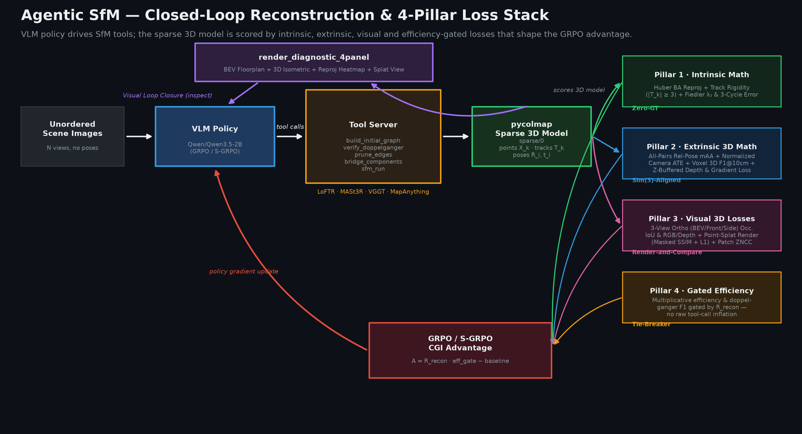
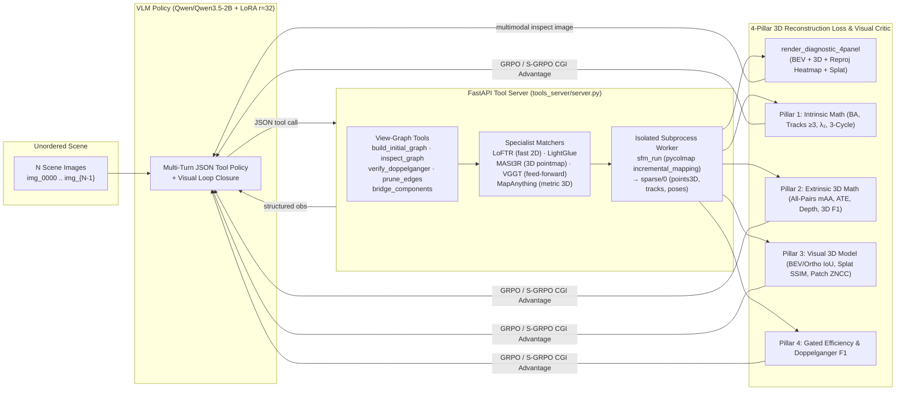
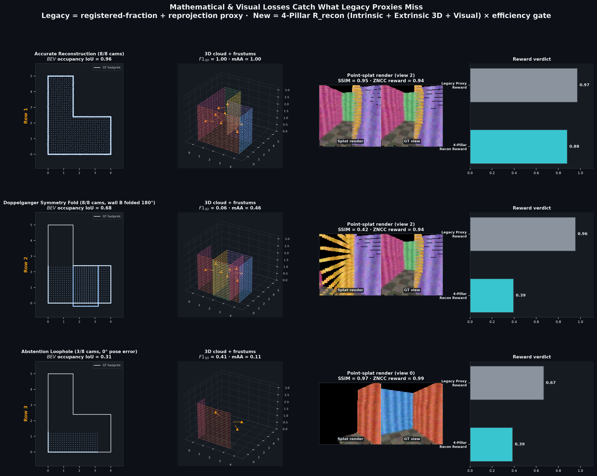
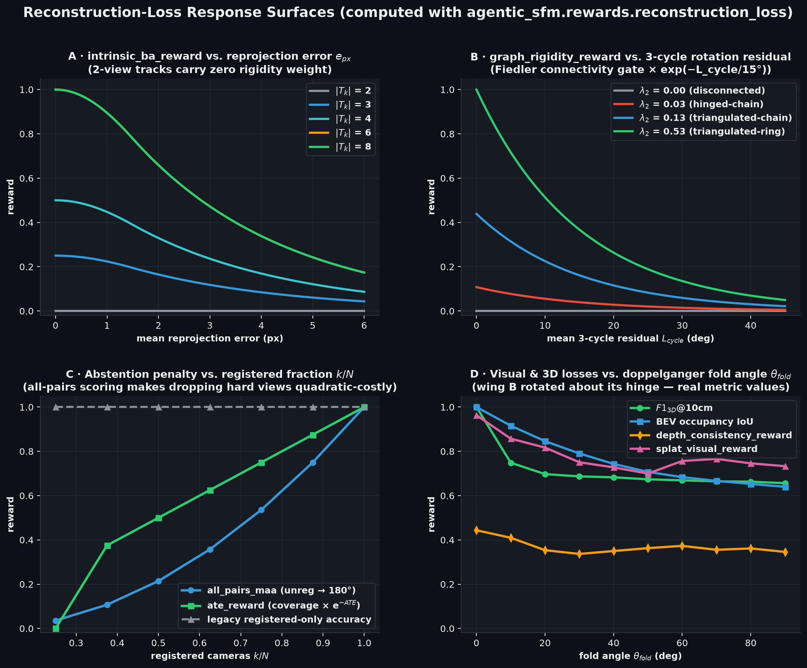
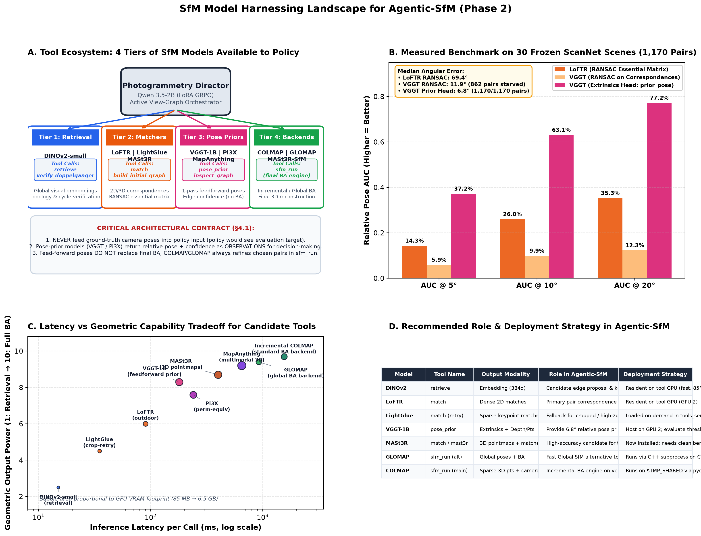

<div align="center">

# Agentic SfM

### RL-Trained Multimodal Agents for Hard 3D Reconstruction & View-Graph Orchestration

[](#quick-start)
[](https://huggingface.co/Qwen/Qwen3.5-2B)
[](#pose-prior-study)
[](#how-it-works)
[](https://huggingface.co/Ryukijano/agentic-sfm-qwen35-2b)
[](LICENSE)

[**Overview**](#summary) · [**Architecture**](#how-it-works) · [**3D Reconstruction Losses (Math + Visual)**](#mathematical--visual-3d-reconstruction-losses) · [**Pose Priors & Routing**](#pose-prior-study) · [**OPSFT**](#opsft-style-constrained-sft) · [**Empirical Results & Audit**](#results) · [**Quick Start**](#quick-start)

</div>

<p align="center">
  
</p>

---

## Summary

**Agentic SfM** investigates whether a compact vision-language model (`Qwen/Qwen3.5-2B`, LoRA $r=32$) can learn to act as a **Photogrammetry Director**—actively constructing, diagnosing, pruning, and bridging a multi-view correspondence graph across classical and feed-forward 3D specialists (`LoFTR`, `MASt3R`, `VGGT`, `MapAnything`) so that incremental Structure-from-Motion (`pycolmap`) succeeds on low-overlap, wide-baseline, and visually symmetric ("doppelganger") scenes where fixed single-matcher pipelines fail.

Instead of relying on human preference labels or easily gamed tool-call proxies, the agent is trained with Group Relative Policy Optimization (**GRPO / S-GRPO CGI**) driven by **verifiable mathematical and visual 3D reconstruction losses** evaluated directly on the reconstructed 3D model (`sparse/0`), ground-truth camera trajectories, and RGB-D sensor geometry.

> **Scientific honesty & current status (`mixed, with named blockers`):**
> - **Pair-level RL:** The pair-level agent does not yet beat plain full-frame LoFTR on the hard validation split (62% vs 88% success).
> - **Scene-level hybrid GRPO (run `8237240`):** Completed 50 epochs on 3×L40S (mean reward `0.847 → 1.643`, best in-training eval score `0.608`), but starting from a LoFTR-only SFT warm start caused **matcher collapse** (0 calls to MASt3R/VGGT). Track-B anti-collapse fixes (diagnostic-conditioned mixed-specialist SFT + $\epsilon$-forced specialist exploration + monotonic correspondence union) are now implemented to address this.
> - **Specialist heterogeneity is large (job `8235219`):** Across 1,170 frozen ScanNet pairs (30 scenes), VGGT's extrinsics head (`AUC@10 = 0.631`, `6.79°` median error) and MASt3R (`AUC@10 = 0.506`, `6.65°`) dramatically outperform LoFTR (`AUC@10 = 0.240`, `68.85°`), while LoFTR is ~20× faster (`0.062s` vs `~1.26s`).
> - **4-Pillar Mathematical + Visual 3D Reconstruction Loss Stack:** Implemented and unit-tested (`src/agentic_sfm/rewards/reconstruction_loss.py`, [`docs/reconstruction_losses.md`](docs/reconstruction_losses.md)) to eliminate the abstention and doppelganger symmetry-fold loopholes of legacy proxy rewards.
> - **No claim in this repository should be read as the learned agent outperforming an equally-budgeted baseline until the held-out 30-scene frozen evaluation matrix completes.**

---

## Status at a Glance

| Phase / Component | Status | Key Finding / Capability | Evidence & Code |
|---|---|---|---|
| **0. Zero-shot cropping** | Done | Stock VLM cropping does not beat direct full-frame matching (`8.9` vs `12.4` mean inliers). Motivates RL. | [`results/README.md`](results/README.md), `results/phase0/comparison.json` |
| **Pair-level SFT** | Done | Warm-start LoRA adapter teaches the valid JSON tool-call contract. | `outputs/sft/`, `outputs/phase1_hard/warmstart/` |
| **1. Pair-level GRPO** | Evaluated (step 200) | `62%` success vs LoFTR `88%` on hard val ($n=50$). Worse than plain LoFTR. | `outputs/eval_pair/phase1_hard_best_8019429.json` |
| **2. Scene-level GRPO** | 50 epochs done | `30%` success on 10 scenes, but protocol audit found train/eval overlap and non-comparable baselines. | `outputs/phase2/run_8073061/`, [`docs/scene_eval_and_env_proposal.md`](docs/scene_eval_and_env_proposal.md) |
| **Pose-prior benchmark** | Done (job `8235219`) | On 1,170 frozen ScanNet pairs: **VGGT prior AUC@10 `0.631`** (`6.79°`), **MASt3R `0.506`** (`6.65°`), **LoFTR `0.240`** (`68.85°`, 20× faster). | `outputs/bench_pose_priors/run_8235219/`, `src/agentic_sfm/pose_prior.py` |
| **Hybrid scene GRPO** | Done (job `8237240`) | 50 epochs on 3×L40S; reward `0.847 → 1.643`, eval `0.608`. Exposed LoFTR-only SFT matcher collapse. | `outputs/phase2_hybrid/run_8237240/`, `configs/phase2_hybrid.yaml` |
| **Track-B anti-collapse & MapAnything** | Implemented & tested | Diagnostic-conditioned specialist SFT (`matcher="mixed"`), $\epsilon$-forced GRPO exploration, `mapanything` backend, monotonic match union, budget scaling evaluator. | `scripts/build_scene_sft.py`, `scripts/eval_budget_scaling.py`, `tools_server/server.py` |
| **4-Pillar 3D Reconstruction Losses** | Implemented & tested | Intrinsic BA/track/$\lambda_2$/cycle math + Extrinsic $\mathrm{Sim}(3)$ all-pairs mAA/ATE/depth/3D-$\text{F}_1$ + Visual 3-view BEV/ortho, point-splat SSIM, patch ZNCC, & 4-panel VLM loop closure. | `src/agentic_sfm/rewards/reconstruction_loss.py`, [`docs/reconstruction_losses.md`](docs/reconstruction_losses.md) |
| **OPSFT constrained SFT** | Implemented & extracted | LoRA bf16 adaptation of arXiv:2609.36659. Exact support is `99.998%` dense under AdamW; top-10% mask selects `3.36M / 33.6M` params. | `src/agentic_sfm/opsft.py`, `scripts/run_sft_opsft.py`, [`docs/opsft.md`](docs/opsft.md) |
| **Calder 8×H200 & Isambard 4×GH200** | Staged & ready | 40-scene ScanNet + MegaDepth curriculum, vLLM TP=2 @ 16k ctx, parallel OPSFT arms, and 30-scene frozen evaluation matrix. | `configs/phase2_calder_8xh200.yaml`, `configs/phase2_isambard_4xgh200.yaml`, [`docs/calder_h200_runbook.md`](docs/calder_h200_runbook.md) |

---

## How It Works

### Closed-Loop Agentic Architecture



Each `sfm_run` executes in a sandboxed subprocess (`tools_server/sfm_worker.py`) so COLMAP/FAISS C++ faults never crash the tool server. When `use_agent_matches=True`, COLMAP imports the **exact union of verified correspondences** gathered by the agent's specialist calls across the active view-graph edges rather than running an independent SIFT pass—directly coupling 3D reconstruction quality to the agent's routing and pruning decisions.

<p align="center">
  
</p>

### Tool Vocabulary (Pair-Level & Scene-Level)

| Scope | Tool | Arguments | What It Returns / Does |
|---|---|---|---|
| **Scene Graph** | `build_initial_graph` | `{"k_neighbors": 5, "matcher": "loftr\|mast3r\|vggt\|mapanything"}` | Retrieves DINOv2 top-$k$ candidate pairs, runs batch matching, builds `ViewGraph`, returns components, bridges, and suspicious cycles. |
| **Scene Graph** | `inspect_graph` | `{}` | Returns topology summary: connected components, isolated images, articulation bridges, and cycle rotation residuals. |
| **Scene Graph** | `verify_doppelganger` | `{"image_a": "img_0000", "image_b": "img_0001", "matcher": "..."}` | Combines DINOv2 appearance similarity, inlier ratio, and 3-cycle geodesic rotation residual ($\|\log(R_{wu}R_{vw}R_{uv})\|$) to flag illusory symmetry edges. |
| **Scene Graph** | `prune_edges` | `{"pairs": [["img_0000", "img_0001"]]}` | Removes flagged doppelganger/outlier edges from the active view graph and match store before reconstruction. |
| **Scene Graph** | `bridge_components` | `{"comp_a_id": 0, "comp_b_id": 1, "budget": 3, "matcher": "..."}` | Queries cross-component candidate pairs with a stronger 3D specialist (`vggt`/`mast3r`/`mapanything`) to merge split subgraphs. |
| **Pair & Scene** | `crop` / `match` | `{"image_a": "...", "image_b": "...", "matcher": "..."}` | Runs pairwise matching (or sub-region crop matching) and caches verified inlier keypoints in the session store. |
| **Reconstruction** | `sfm_run` | `{}` | Runs `pycolmap.incremental_mapping` on active graph matches; writes `sparse/0` and returns `num_registered`, `num_points3d`, `mean_reproj_error`, `num_components`. |
| **Verification** | `inspect` / `done` | `{}` | Reads detailed model diagnostics (plus 4-panel 3D visual render) or terminates the episode for reward scoring. |

### Multi-GPU Hardware Layouts

| Cluster Target | GPUs | Layout Across Node | Config & Slurm Launcher |
|---|---|---|---|
| **AIRE** | 3× NVIDIA L40S (48 GB) | `GPU 0`: vLLM rollout · `GPU 1`: LoRA trainer · `GPU 2`: Tool server | `configs/phase2_hybrid.yaml`, `jobs/phase2_hybrid.slurm` |
| **Calder** | 8× NVIDIA H200 NVL (141 GB) | `GPU 0,1`: vLLM TP=2 (16k ctx) · `GPU 2`: Tool server · `GPU 3`: Trainable LoRA · `GPU 4`: Frozen KL anchor · `GPU 5,6`: OPSFT ablation arms · `GPU 7`: Frozen 30-scene eval | `configs/phase2_calder_8xh200.yaml`, `jobs/calder_8xh200_hybrid.slurm` |
| **Isambard-AI** | 4× NVIDIA GH200 (96 GB) | `GPU 0`: vLLM rollout · `GPU 1`: Tool server (LoFTR+MASt3R+VGGT+MapAnything) · `GPU 2`: Trainable LoRA · `GPU 3`: Frozen KL anchor | `configs/phase2_isambard_4xgh200.yaml`, `jobs/isambard_4xgh200_hybrid.slurm` |

---

## Mathematical & Visual 3D Reconstruction Losses

A central finding of our Phase 2 audit ([`docs/scene_eval_and_env_proposal.md`](docs/scene_eval_and_env_proposal.md)) is that **tool-call syntax bonuses and registered-only camera rotation errors are easily reward-hacked**:
1. **The Abstention Trap:** Registering only 3 easy consecutive frames yields `0.0°` pose error on the registered subset while ignoring 85% of the scene.
2. **The Doppelganger Symmetry Fold:** An unpruned visual symmetry edge folds Wall B ($180^\circ$) onto Wall A. All 8 cameras still register (`100%` registration) and 2-view reprojection error on the bad pair looks small, yet the 3D model is geometrically and visually broken.

To solve this, `src/agentic_sfm/rewards/reconstruction_loss.py` ([full specification in `docs/reconstruction_losses.md`](docs/reconstruction_losses.md)) implements a **Four-Pillar Mathematical & Visual 3D Reconstruction Loss** stack that scores the 3D model itself:

<p align="center">
  
</p>

### The Four Pillars at a Glance

| Pillar | Loss / Reward Component | Mathematical Formulation | What Failure Mode It Kills | Needs GT? |
|---|---|---|---|---|
| **Pillar 1: Intrinsic Math** | **Track-Conditioned Huber BA ($\mathcal{R}_{\text{BA}}$)** | $\exp\!\big(-\frac{1}{2|\mathcal{P}|}\sum_k w_k \rho_H(e_k/\sigma_{\text{px}})\big) \cdot \operatorname{clip}\!\big(\frac{\bar{\ell}_{\mathcal{T}}-2}{4},0,1\big) \cdot f_{|\mathcal{T}_k|\ge 3}$ | 2-view-only zero-redundancy triangulations & high-residual floaters | **No** (Zero-GT) |
| **Pillar 1: Intrinsic Math** | **Fiedler $\lambda_2$ & 3-Cycle Rigidity ($\mathcal{R}_{\text{graph}}$)** | $\operatorname{clip}(\lambda_2(\mathcal{L}_{\text{norm}})/0.3, 0, 1) \cdot \exp(-\mathcal{L}_{\text{3-cycle}}/15^\circ)$ | Disconnected subgraphs ($\lambda_2=0$), hinged bridges, & inconsistent loop closures | **No** (Zero-GT) |
| **Pillar 2: Extrinsic 3D Math** | **All-Pairs Relative Pose mAA ($\mathcal{R}_{\text{mAA}}$)** | $\frac{1}{\binom{N}{2}}\sum_{i<j}\frac{1}{3}\sum_{\tau\in\{5,10,20^\circ\}}\mathbb{1}[\max(\epsilon^R_{ij},\epsilon^t_{ij})<\tau]$ *(unregistered $\to 180^\circ$)* | **Abstention loophole** (dropping hard views costs quadratically) | Yes (GT poses) |
| **Pillar 2: Extrinsic 3D Math** | **$\mathrm{Sim}(3)$ Camera ATE ($\mathcal{R}_{\text{ATE}}$)** | $\text{cov}\cdot\exp\!\big(-\frac{1}{|M|}\sum_{i\in M}\rho_H(\|sR_s\hat{C}_i+t_s-C^{\text{gt}}_i\|_2 / D_{\text{gt}})\big)$ | Collapsed or hinged camera trajectories with good orientations | Yes (GT poses) |
| **Pillar 2: Extrinsic 3D Math** | **Z-Buffered Depth + Gradient ($\mathcal{L}_{\text{depth}}$)** | $\frac{1}{|\mathcal{O}|}\sum|\log(\hat{z}_{ik}/z^{\text{gt}}_{ik})| + \lambda_\nabla\sum|(\hat{z}_{ik}-\hat{z}_{ik'})-(z^{\text{gt}}_{ik}-z^{\text{gt}}_{ik'})|$ | Depth-order inversions & wall-doubling against RGB-D sensor depth | Yes (ScanNet depth) |
| **Pillar 2: Extrinsic 3D Math** | **Voxel-Normalized 3D $\text{F}_1@\tau$ ($\mathcal{R}_{\text{3D-F1}}$)** | $\frac{2\cdot P@\tau\cdot R@\tau}{P@\tau+R@\tau}$ between $\mathcal{P}'_{\text{pred}}$ and voxelized $\mathcal{V}_{\text{gt}}$ ($\tau=10\text{cm}$) | Outlier 3D point clouds (low $P$) & missing room surfaces (low $R$) | Yes (GT 3D cloud) |
| **Pillar 3: Visual 3D Model** | **3-View Orthographic Render ($\mathcal{R}_{\text{ortho-3D}}$)** | Mean over $\{\text{BEV}, \text{Front}, \text{Side}\}$ of $0.45\,\operatorname{IoU}(O^{\text{pred}}_v, O^{\text{gt}}_v) + 0.30(1-\ell_1^{\text{RGB}}) + 0.25(1-\ell_1^Z)$ | **Doppelganger symmetry folds** rotating walls/corridors outside the true floorplan | Yes (GT 3D cloud) |
| **Pillar 3: Visual 3D Model** | **Differentiable Point-Splat Render ($\mathcal{R}_{\text{splat}}$)** | Front-to-back $\alpha$-composited splats $\hat{C}_i$: $\text{gate}(\hat{O}_i)\cdot(0.6\,\operatorname{SSIM}_{M_i} + 0.4(1-\ell_1))$ | Ghosted/misaligned 3D geometry when rendered back into camera views | No (Observed RGB) |
| **Pillar 3: Visual 3D Model** | **Multi-View Patch ZNCC ($\mathcal{R}_{\text{patch-cons}}$)** | $1 - \frac{1}{|\mathcal{P}|}\sum_k\frac{1}{|\mathcal{T}_k|}\sum_{i\in\mathcal{T}_k}\big[0.5(1-\operatorname{ZNCC}(W_i,\bar{W}_k)) + 0.5\|W_i-\bar{W}_k\|_1\big]$ | Cross-view texture mismatch when a folded camera projects points onto wrong walls | **No** (Zero-GT) |
| **Visual Loop Closure** | **4-Panel Diagnostic Render (`render_diagnostic_4panel`)** | $2\times 2$ composite: Top-Down BEV Floorplan + 3D Isometric + Reproj Heatmap + Splat View | Gives `Qwen3.5-2B` direct visual perception of its 3D model during `inspect` | **No** (Zero-GT) |

<p align="center">
  
</p>

---

## Results

Every number below comes from the file named in its subsection. Paper numbers are labelled as such. All inference outputs live under [`results/`](results/) or `outputs/`. See [`results/README.md`](results/README.md) for the bundled Phase 0 outputs.

Trained LoRA adapters (pair SFT, Phase 1 GRPO, scene SFT) and figures are on Hugging Face: [huggingface.co/Ryukijano/agentic-sfm-qwen35-2b](https://huggingface.co/Ryukijano/agentic-sfm-qwen35-2b).

### Phase 0: Zero-Shot Cropping

Source: `results/README.md` and `results/phase0/comparison.json`.

Question: does stock Qwen3.5-2B cropping beat direct matching without RL?

<p align="center">
  
</p>

| Method | Mean inliers | Pose AUC |
|--------|-------------:|---------:|
| Direct LoFTR | 12.4 | 0.017 |
| Direct MASt3R | 12.4 | 0.017 |
| Zero-shot agent | 8.9 | 0.017 |

Result: zero-shot tool use is worse than direct matching on these hard pairs, and it does not improve pose AUC. This is a negative result, and it is the motivation for training.

On the 12 real MegaDepth pairs (scenes 0015 and 0022, `results/phase0_real/real_results.json`), the zero-shot agent chose full-frame crops, so agent and direct inlier counts are identical. That run does not test cropping.

Qualitative overlays (scenes 0015 and 0022):

<p align="center">
  
</p>

<p align="center">
  
</p>

<p align="center">
  
</p>

Per-pair overlays: [`results/phase0_real/visualizations/`](results/phase0_real/visualizations/).

### Phase 1: Pair-Level RL

Source: `outputs/eval_pair/phase1_hard_best_8019429.json`. The trained checkpoint is `outputs/phase1_hard/checkpoints/best`. The policy was trained with GRPO on the hard-pair training split, starting from the SFT warm start.

Headline comparison on the hard validation split (n = 50):

| Method | Success | Geometric reward | Mean pose AUC | Mean inliers |
|---|---:|---:|---:|---:|
| Trained agent (`phase1_hard_best`) | 62% | 0.595 | 0.52 | 339.7 |
| Plain LoFTR | 88% | 0.965 | (not in file) | (not in file) |
| Oracle crop baseline | 90% | 1.111 | (not in file) | (not in file) |

The trained agent is worse than LoFTR on this split, and worse than the oracle crop baseline. The file's `comparison` block reports deltas of −0.370 geometric reward and −26 points success against LoFTR.

Full validation set (n = 153), same file (`full_val`):

| Split | Success | Mean pose AUC | Mean inliers | Mean tool calls |
|---|---:|---:|---:|---:|
| Full val (n=153) | 58% | 0.486 | 364.7 | 2.0 |
| Hard (n=50) | 62% | 0.520 | 339.7 | 2.0 |

The 62% success figure applies only to the hard subset. Full-validation success is 58%.

Reward is not comparable across rows. The training reward includes a +0.5 first-call validity bonus (`configs/phase1_grpo.yaml`, `first_call_validity_weight: 0.5`). The "geometric reward" column is the reward without that bonus, and it is the number to compare with LoFTR.

Training state. GRPO job 7969850 ran to about step 200, then hit its 2-day time limit and was cancelled. The last logged step reported a mean reward of 1.493 (step 200, including the validity bonus). The log is at `/scratch/kcwp264/logs/agentic-sfm/grpo_hard_training_7969850.log` (outside the repository). It confirms `Step 200: reward=1.493 ± 0.616`, and step 200 is the last logged step. Do not compare the 1.493 value with any LoFTR number; it includes the bonus.

Best-match episodes logged during early GRPO training (qualitative only; green = verifier inlier, red = outlier; titles give verified inlier count and episode reward; these are from the earlier training run and are not a result):

| Step 10 | Step 20 | Step 30 |
|---|---|---|
|  |  |  |

### Phase 2: Scene-Level RL

Sources: `outputs/phase2/run_8073061/` (training) and `outputs/scene_eval/run_8085187/scene_eval_results.json` (evaluation). The best checkpoint is `outputs/phase2/run_8073061/checkpoints/best_eval`. Training completed 50 epochs.

The evaluation set is 10 scenes: MegaDepth 0015 and 0022, and ScanNet `scene0707_00` to `scene0714_00`. Scenes 0015 and 0022 were training scenes. The ScanNet scenes were used during earlier design decisions and are no longer held out. This evaluation is therefore not a valid final benchmark.

Agent aggregate (`scene_eval_results.json`, `agent.aggregate`):

| Metric | Value |
|---|---:|
| Success rate (≥50% registered and mean pose error <20°) | 0.30 (3/10) |
| Mean registered coverage | 0.425 |
| Mean reconstruction success | 0.30 |
| Mean relative AUC@5 / @10 / @20 | 0.34 / 0.58 / 0.74 |
| Mean total reward | 0.997 |

Mean pose error across the 10 scenes is 28.9° (computed from the per-scene `pose/reported_mean_error_deg` values).

Per-scene results, agent arm:

| Scene | Role | Registered | Coverage | Mean pose error (°) | Rel AUC@10 | Success | Reward |
|---|---|---:|---:|---:|---:|:---:|---:|
| MegaDepth 0015 | train | 9/20 | 0.45 | 0.35 | 0.94 | no | 1.17 |
| MegaDepth 0022 | train | 12/20 | 0.60 | 2.75 | 0.86 | yes | 1.72 |
| scene0707_00 | ScanNet | 12/20 | 0.60 | 67.7 | 0.50 | no | 0.80 |
| scene0708_00 | ScanNet | 4/20 | 0.20 | 166.5 | 0.00 | no | 0.60 |
| scene0709_00 | ScanNet | 9/20 | 0.45 | 3.09 | 0.78 | no | 1.11 |
| scene0710_00 | ScanNet | 10/20 | 0.50 | 11.18 | 0.69 | yes | 0.97 |
| scene0711_00 | ScanNet | 8/20 | 0.40 | 5.88 | 0.79 | no | 0.98 |
| scene0712_00 | ScanNet | 4/20 | 0.20 | 16.45 | 0.00 | no | 0.64 |
| scene0713_00 | ScanNet | 7/20 | 0.35 | 13.33 | 0.33 | no | 0.79 |
| scene0714_00 | ScanNet | 10/20 | 0.50 | 2.11 | 0.87 | yes | 1.20 |

Source for each column: `registration/num_registered`, `registration/num_images`, `pose/reported_mean_error_deg`, `pose/rel_auc_10`, `reconstruction/success`, and `scene/reward` in `scene_eval_results.json`.

The main bottleneck is coverage, not pose accuracy. Scene 0015 has a mean pose error of 0.35° on its 9 registered images, but only 9 of 20 images are registered, so it fails the success gate. Scenes 0708 and 0712 register 4 of 20 images and have near-zero relative AUC@10.

Caveats for the other two arms in the same file:

1. **Direct arm: 0% success is an artefact.** The direct-baseline run did not inject `mean_pose_error_deg`, so success reads a missing value and is always false. Commit `2d5f247` fixes this for the direct arm. Relative AUC is computed for that arm only where poses are available (6 of 10 scenes in this run), and its success rate must not be read as a result.
2. **Oracle arm is not an upper bound.** It matched only the first 5 pairs (`top_pairs[:5]`, `src/agentic_sfm/rl/scene_episode.py`). Five pairs cannot register a 20-image scene. Its aggregate success is 0%, and 8 of 10 oracle episodes logged a tool error. It is a weak baseline, not an oracle.
3. **ScanNet overlap is a proxy.** Overlap for ScanNet is inferred from pose similarity, not from covisibility ground truth.
4. **Coverage dominates success.** See the scene 0015 example above.

The ScanNet dense ground-truth cloud below (about 200k points, rendered from depth and pose) is the evaluation target, not an agent output:

<p align="center">
  
</p>

Composite summary from earlier development (hard pair, good pair, sparse reconstruction, ScanNet ground truth, reward curve):

<p align="center">
  
</p>

Reward is not evidence of reconstruction quality. The first-call validity bonus is 0.5 per episode and makes up about half of the reward on several scenes (for example, 0.5 of 1.17 on scene 0015). Mean total reward of 0.997 should not be cited as a quality measure.

### Pose-Prior Study

Status: implemented, unit-tested, and benchmarked on 30 frozen ScanNet scenes (rerun job 8235219, completed Oct 11, 2026).

Question: can feed-forward pose models (VGGT, MASt3R) be used as matcher backends and pose sources for the agent, and do they beat LoFTR?

What exists:

- `src/agentic_sfm/pose_prior.py`: converts point-map outputs to reciprocal-nearest-neighbour correspondences and A→B relative poses (pure numpy).
- `tools_server/server.py`: `matcher="vggt"`, `matcher="mast3r"`, and `matcher="mapanything"` backends, with LoFTR fallback tagged `matcher_fallback`.
- `data/frozen_eval_manifest.json`: 30 ScanNet scenes from `scene0715_00` onward. `scene0718_00` is excluded (19 frames). The manifest's `sha256` field is `d62928353a2c3bff7ac0aa77b0f8b844059dc8035d23bd336228036a56bd0825`. It is a hash of the canonical JSON of all other fields, recomputable with `python scripts/freeze_scene_manifest.py --verify`. The file's byte-level sha256 is different.
- `scripts/bench_pose_priors.py` and `jobs/bench_pose_priors.slurm`: benchmark `loftr`, `vggt`, and `mast3r` on identical per-scene pair lists (19 consecutive and 20 seeded-random pairs per scene), using GT intrinsics, IMC-style worst-of-two relative error, and AUC@5/10/20. Failures and fallbacks count as failures.

<p align="center">
  
</p>

Job status: rerun benchmark job 8235219 completed in 52 minutes on one L40S. Output: `outputs/bench_pose_priors/run_8235219/` (`bench_pose_priors.json`, `summary.md`).

Setup: 30 frozen ScanNet scenes, 39 identical pairs per scene (19 consecutive, 20 seeded-random), 1,170 pairs per matcher. Pair error is the worst of rotation and translation-direction error, in degrees. Pairs with no pose count as failures in every AUC, so the AUC denominator is always 1,170.

| Pose source | AUC@5 | AUC@10 | AUC@20 | Pairs with a pose | Median error | Median latency |
|---|---|---|---|---|---|---|
| LoFTR, RANSAC essential matrix | 0.137 | 0.240 | 0.349 | 1,170 / 1,170 | 68.85° | 0.062s |
| VGGT, RANSAC on correspondences ($t=3.0$) | 0.120 | 0.191 | 0.244 | 484 / 1,170 | 11.70° (on valid pairs) | 1.280s |
| VGGT, its own extrinsics head (`prior_pose`) | **0.372** | **0.631** | **0.772** | 1,170 / 1,170 | **6.79°** | 1.280s |
| MASt3R, pointmap matching & pose | 0.355 | 0.506 | 0.579 | 988 / 1,170 | 6.65° | 1.255s |

What this shows:

- **VGGT's extrinsics head gives the strongest pose measured**: It returned a pose for every pair, with AUC@10 of 0.631 and median angular error of 6.79°, compared to 68.85° for LoFTR.
- **MASt3R is competitive on geometry**: With the clean import environment, MASt3R completed without fallback on 84.4% of pairs, achieving median angular error of 6.65° and AUC@10 of 0.506.
- **Latency vs. geometry tradeoff**: LoFTR is ~20× faster (0.062s vs ~1.26s), but fails on wide-baseline or low-overlap indoor pairs where VGGT and MASt3R succeed. This motivates the hybrid policy where the LLM selects when to call high-cost matchers.
- **VGGT confidence threshold tuning**: Lowering the threshold from 5.0 to 3.0 (from diagnostic job 8214266) improved correspondence availability from 21.9% to 41.4% without degrading inlier quality.
- **The VGGT prior result is not yet a clean comparison**: VGGT's paper lists ScanNet among its training datasets (arXiv 2503.11651, section 3.4). For its own ScanNet-1500 matching comparison, the authors say they excluded the corresponding ScanNet scenes from training. Our frozen scenes come from the same ScanNet-1500 test folder, but the paper does not list the excluded scene IDs, and the released training code has no ScanNet loader. Overlap is unlikely but unconfirmed.

Paper numbers, not reproduced here: VGGT reports AUC@30 of 85.3 on Re10K and 88.2 on CO3Dv2 without bundle adjustment (paper Table 1, arXiv 2503.11651). These are the paper's numbers on its benchmarks and are not evidence about our data.

### Hybrid Scene GRPO (run 8237240) & Track-B Anti-Collapse Routing

Source: `outputs/phase2_hybrid/run_8237240/` and `/scratch/kcwp264/logs/agentic-sfm/phase2_train_8237240.log`. Config: `configs/phase2_hybrid.yaml` (all three matchers exposed; group_size 4; 50 epochs; scenes 0015+0022 only — ScanNet was disabled in this run). The job ran ~31 h on 3×L40S (gpu023) after dynamic-port allocation fixed the vLLM startup collision that killed job 8235218.

Training trajectory (from the log):

| Metric | Epoch 0 | Best eval (ep 25) | Final (ep 50) |
|---|---:|---:|---:|
| Mean train reward | 0.847 | 1.324 | 1.643 |
| In-training eval score | — | **0.608** | 0.450 |
| Eval pose error | 3.70° (ep 4) | **2.62°** | 6.14° |
| Eval registered fraction | 0.275 | **0.700** | 0.650 |
| LoRA L2 distance from SFT init | 0 | 0.194 | 0.259 |

Caveats:

1. **The eval is not held out.** The in-training eval uses scenes 0015 and 0022, which are also the training scenes. Best-eval 0.608 is a training-set number.
2. **Matcher collapse & Track-B Remedies.** The policy issued zero MASt3R or VGGT calls across 50 epochs because the SFT warm start contained LoFTR-only trajectories, collapsing matcher-token probability before RL. To solve this for the Calder/Isambard runs:
   - `scripts/build_scene_sft.py` now supports `matcher="mixed"` (`select_diagnostic_specialist_matcher`), routing low-overlap/indoor pairs and `bridge_components` calls to 3D specialists (`vggt`, `mast3r`, `mapanything`) in the SFT warm start.
   - `src/agentic_sfm/rl/scene_episode.py` and `scripts/run_scene_grpo.py` implement $\epsilon$-forced specialist exploration (`matcher_explore_eps` with decay and group-slot stratification), synchronizing rewritten assistant JSON tool calls so GRPO policy gradients reinforce explored specialist tokens.
   - `run_scene_grpo.py` logs `scene/matcher_frac_{loftr,mast3r,vggt,mapanything}` and `scene/matcher_fallback_pairs` per step/eval.
3. **Context overflow.** 129 episodes hit the 8,192-token vLLM cap. The Calder and Isambard configs raise `max_model_len` to 16,384.
4. **Reward includes the +0.5 first-call bonus**; it is not a pure quality measure.

### OPSFT-Style Constrained SFT

Implementation of "On-Policy Parameter Update Direction Underlies Generalization in LLM Post-Training" (arXiv 2609.36659), adapted from full-parameter FP32 to **LoRA adapters under bf16** — an adaptation experiment, not a direct reproduction.

What exists:

- `src/agentic_sfm/opsft.py`: `canonical_lora_name`, `extract_direction` (exact-support or global top-k |Δθ|), `save_direction`/`load_direction`, `mask_gradients_` (pre-step: zero off-support grads and grads whose descent opposes `D`), `project_parameters_` (post-step: restore off-support params to θ0 and snap back wrong-direction movement), `fingerprint_state_dict`.
- `scripts/run_sft_opsft.py`: `OPSFTTrainer(SFTTrainer)` — loads `init_adapter`, snapshots θ0, verifies direction coverage over every trainable adapter param, and applies stage-1 masking before grad clipping and stage-2 projection after `optimizer.step()` under `no_grad`.
- `scripts/run_sft.py` gained no-op `_pre_optim_step`/`_post_optim_step` hooks (ordinary SFT unchanged).
- `scripts/extract_update_direction.py`, `configs/phase2_sft_opsft.yaml`, `jobs/sft_opsft.slurm`, [`docs/opsft.md`](docs/opsft.md).

Measured direction statistics (scene-SFT epoch-5 → hybrid run 8237240 epoch-50, 33,638,400 LoRA elements):

| Artifact | Selected elements | Fraction |
|---|---:|---:|
| Exact support | 33,637,819 | 99.9983% |
| Top-10% \|Δθ\| | 3,363,841 | 10.000% |

**Dense-support caveat (measured):** under AdamW the LoRA update touches ~99.998% of elements, so `exact_support` leaves only the sign constraint binding. The top-k selection approximates the paper's sparse-update regime. Pre-extracted artifacts for run 8237240 (best_eval and epoch_50) are staged under `outputs/opsft/` and in the Calder bundle.

No constrained-SFT results exist yet; both arms (from-base, continue) run inside `jobs/calder_8xh200_hybrid.slurm`.

---

## Known Problems and Invalid Results

This section lists what must not be cited.

| Claim | Status | Correct statement |
|---|---|---|
| "1,535 hard pairs from 102 scenes" (public project page) | Wrong for this repo | `data/hard_pairs_all.json` has 1,535 pairs from **two** scenes: 0015 (402) and 0022 (1,133). |
| Train/val split | Verified | `data/hard_pairs_train.json`: 1,382 pairs (0015: 361; 0022: 1,021). `data/hard_pairs_val.json`: 153 pairs (0015: 41; 0022: 112). |
| "398 hard pairs" (earlier README) | Stale | Comes from an older build. Do not cite. |
| "10 calls, 15 turns" agent limit (public write-up) | Applies to pair level only | Pair configs use 10 calls and 15 turns. Scene configs use 20 calls and 30 turns. |
| Scene eval with 10 scenes (Section Phase 2) | Not a valid benchmark | Two training scenes, ScanNet scenes already used in design, direct success is an artefact, oracle is 5 pairs. |
| Reward climb 0.374 → 0.496 (earlier README, W&B) | Not re-verified | Not reproduced in this snapshot. Omitted from results. |
| Phase 1 reward 1.493 at step 200 | Verified in `grpo_hard_training_7969850.log`; step 200 is the last logged step | See Phase 1 section. Includes validity bonus; not comparable to LoFTR. |
| Agent beats LoFTR or any baseline | Not supported | Phase 1 is worse than LoFTR and the oracle crop baseline on hard val. Phase 2 has no valid baseline comparison. The hybrid run never sampled MASt3R/VGGT, so it cannot support a routing claim either. |
| "Hybrid routing works" | Not supported | Run 8237240 issued zero calls to MASt3R/VGGT (matcher collapse at SFT warm start). Routing benefit is unproven pending forced-exploration/mixed-trajectory fixes and a LoFTR-only control at identical budget. |
| Phase 1 and Phase 2 "running" | Incorrect | Phase 1 was stopped at about step 200. Phase 2 training finished; its evaluation is not a valid benchmark. |
| Phase-1 GRPO checkpoints (`outputs/phase1*/checkpoints/{best,best_eval,epoch_5,latest}`) | Untrusted | These were written byte-identical to their SFT init (a checkpoint persistence bug). Changed adapters exist only under `outputs/sgrpo_smoke/checkpoints/latest` and `outputs/phase2_hybrid/run_8237240/checkpoints/`. |
| Hard-pair distribution figure (`results/figures/agentic_sfm_hardpairs_distribution.png`) | Provenance not checked | It may show the older build. Do not use it for pair counts. |

---

## Evaluation Protocol (Next)

The planned protocol replaces the current scene evaluation. The full rationale is in [`docs/scene_eval_and_env_proposal.md`](docs/scene_eval_and_env_proposal.md) and [`docs/reconstruction_losses.md`](docs/reconstruction_losses.md).

- **Held-out scenes.** ScanNet `scene0715_00` onward, frozen in `data/frozen_eval_manifest.json`. At least 30 scenes with 20 frames each. MegaDepth 0015 and 0022 are excluded from every held-out claim.
- **Metrics.** Registration fraction (counting unregistered images as failures), relative pose mAA@5/10/20 over **all** $\binom{N}{2}$ image pairs, $\mathrm{Sim}(3)$ camera ATE, voxel-normalized 3D $\text{F}_1@10\text{cm}$, BEV floorplan IoU, and component/failure taxonomy. The 50%/20° gate is a secondary summary.
- **Baselines, same `sfm_run` path with cached matches.** Consecutive-frame pairs, random pairs, top-k retrieval (k = 5 and 10), direct matching with pose error, an oracle over ground-truth-overlap pairs (heuristic on ScanNet), and the SFT-only checkpoint. All at equal tool-call budget.
- **Statistics.** The scene is the unit. Paired scene-level differences against each baseline, with scene-level bootstrap intervals. A superiority claim requires the interval to exclude zero.
- **Gates before new RL.** The fair oracle reconstructs at least as well as exhaustive matching. The direct baseline reports pose error. At least 30 frozen scenes. The SFT-only checkpoint is evaluated. The policy beats the consecutive-frame heuristic at equal budget, with an interval excluding zero.

---

## Quick Start

### Environment

On **Calder (8×H200)**:

```bash
source /users/kcwp264/calder-setup/bootstrap/calder_env.sh
export PATH=/scratch-calder/users/kcwp264/envs/miniforge/agentic-sfm/bin:$PATH
```

On **AIRE (3×L40S)**:

```bash
source /scratch/kcwp264/.aire_scratch_env.sh
export PATH=/scratch/kcwp264/.conda_envs/agentic-sfm/bin:$PATH
```

Generic installation on other machines:

```bash
conda create -n agentic-sfm python=3.11 -y
conda activate agentic-sfm
pip install -e ".[dev,rl]"
```

Caches (Hugging Face, uv, Torch, W&B) belong on scratch, not `$HOME`.

### 1. Start the Tool Server

```bash
python tools_server/server.py
# → http://localhost:8765/health   (port set by TOOL_SERVER_PORT, default 8765)
```

`scripts/start_tool_server.sh [PORT] [GPU_ID]` starts the same server with uvicorn on GPU 2 by default, in the background.

### 2. Run the Test Suite & Regenerate Loss Diagrams

```bash
python -m pytest tests/ -q
python scripts/generate_loss_diagrams.py   # regenerates docs/figures/*.png
```

### 3. Phase 0: Zero-Shot Evaluation

```bash
python scripts/run_zeroshot.py --config configs/phase0_zeroshot.yaml
```

### 4. Phase 1: SFT Warm Start, Then GRPO

Stock Qwen3.5-2B needs SFT on oracle crop traces to learn the tool-call contract before GRPO.

```bash
# 1 GPU: LoFTR oracle crops → data/sft_train.jsonl
sbatch jobs/phase1_oracle_sft.slurm

# 1 GPU: LoRA SFT on those traces (Qwen/Qwen3.5-2B)
sbatch jobs/phase1_sft.slurm

# Point configs/phase1_grpo.yaml model.sft_adapter at the SFT checkpoint, then:
sbatch jobs/phase1_grpo.slurm        # general GRPO
sbatch jobs/phase1_grpo_hard.slurm   # hard-pair GRPO

# Pair-level evaluation
sbatch jobs/eval_pair.slurm
```

### 5. Phase 2: Scene SFT and GRPO

```bash
sbatch jobs/phase2_sft_scene.slurm
sbatch jobs/phase2_scene.slurm

# Scene evaluation (not a valid benchmark; see Known problems)
sbatch jobs/eval_scene.slurm
```

### 6. Pose-Prior Benchmark

```bash
sbatch jobs/bench_pose_priors.slurm
```

This job downloads VGGT weights to `$SCRATCH` and uses one L40S for up to 4 hours. It has already been rerun as job 8235219 (52 minutes; the numbers in "Pose-Prior Study"). Do not resubmit unless the run has failed. The output directory is `outputs/bench_pose_priors/run_<jobid>/`. Dry-run check without a GPU: `python scripts/bench_pose_priors.py --dry-run`.

### 7. OPSFT Constrained SFT

```bash
# Extract a direction artifact from an SFT→GRPO checkpoint pair
python scripts/extract_update_direction.py \
  --base outputs/scene_sft_graph_retry2/checkpoints/epoch_5 \
  --trained outputs/phase2_hybrid/run_8237240/checkpoints/epoch_50 \
  --selection topk --topk-frac 0.1 \
  --output outputs/opsft/direction_scene_grpo.pt

# Constrained SFT (auto-extracts if the artifact is missing)
sbatch jobs/sft_opsft.slurm
```

See [`docs/opsft.md`](docs/opsft.md) for the mapping to the paper, the two experiment arms (from-base / continue), and known differences.

### 8. Calder 8×H200 & Isambard-AI 4×GH200 Runs

```bash
# On Calder (8xH200 NVL):
sbatch jobs/calder_8xh200_hybrid.slurm

# On Isambard-AI (4xGH200):
sbatch jobs/isambard_4xgh200_hybrid.slurm
```

See [`docs/calder_h200_runbook.md`](docs/calder_h200_runbook.md) for the storage budget, GPU layout, and the E1–E10 experiment matrix.

---

## Repository Layout

```
agentic-sfm/
├── src/agentic_sfm/
│   ├── agent/                      # Policy, tool-call parsing & execution
│   ├── data/                       # Hard-pair and scene dataset utilities
│   ├── eval/                       # Evaluation: evaluate.py, scene_eval.py, viz.py
│   ├── graph/                      # ViewGraph topology, components, cycle residuals
│   ├── rewards/
│   │   ├── pose_rewards.py         # Pair & scene reward composition
│   │   └── reconstruction_loss.py  # 4-Pillar Mathematical & Visual 3D Reconstruction Losses
│   ├── rl/                         # GRPO helpers, scene episodes, S-GRPO CGI oracle
│   ├── tools/                      # Tool client & doppelganger verifier
│   ├── constants.py
│   ├── geometry.py
│   ├── opsft.py                    # OPSFT direction extraction + constraint enforcement
│   ├── pose_prior.py               # Point-map → correspondences and relative pose
│   ├── verl_agent_loop.py          # VeRL multi-turn agent loop (experimental)
│   └── verl_reward.py              # VeRL reward hook (experimental)
├── tools_server/
│   ├── server.py                   # FastAPI tool server (LoFTR, MASt3R, VGGT, MapAnything, graph tools)
│   └── sfm_worker.py               # Isolated pycolmap child process
├── configs/                        # Phase configs (phase0, phase1_*, phase2_*, Calder 8xH200, Isambard 4xGH200)
├── scripts/
│   ├── generate_loss_diagrams.py   # Generates docs/figures/*.png using live loss functions
│   ├── freeze_scene_manifest.py    # Builds and verifies the 30-scene frozen ScanNet manifest
│   ├── bench_pose_priors.py        # Equal-budget matcher benchmark
│   ├── eval_budget_scaling.py      # 2D tool-budget x RL compute scaling-law evaluator
│   ├── extract_update_direction.py # OPSFT direction extraction CLI
│   ├── run_sft_opsft.py            # Constrained SFT trainer
│   ├── build_scene_sft.py          # Scene SFT generator with diagnostic specialist routing
│   └── eval_scene.py, run_scene_grpo.py, run_grpo.py, run_pair_eval.py, ...
├── data/
│   ├── frozen_eval_manifest.json   # 30 frozen ScanNet scenes, sha256 verified
│   ├── hard_pairs_all.json         # 1,535 pairs (scenes 0015, 0022)
│   ├── hard_pairs_train.json       # 1,382 pairs
│   ├── hard_pairs_val.json         # 153 pairs
│   └── sft_*.jsonl                 # SFT traces
├── docs/
│   ├── reconstruction_losses.md        # Mathematical & visual 3D reconstruction loss spec + Mermaid diagrams
│   ├── scene_eval_and_env_proposal.md  # Evaluation protocol, audit, pose-prior design
│   ├── opsft.md                        # OPSFT constrained-SFT design + commands
│   ├── calder_h200_runbook.md          # Aire→Calder migration + E1–E10 experiment matrix
│   └── figures/                        # Architecture, 3x4 room demo, and response-surface plots
├── paper/main.tex                  # CVPR-style paper draft (self-contained LaTeX)
├── jobs/                           # Slurm launchers (AIRE L40S, Calder H200, Isambard GH200)
├── tests/                          # Unit & integration test suite
├── results/                        # Bundled Phase 0 outputs and figures (see results/README.md)
└── outputs/                        # Run artifacts referenced above (eval JSON, checkpoints)
```

---

## Data

- **MegaDepth.** Scenes 0015 and 0022 are on disk and are the only MegaDepth scenes with images in this setup. The pair files reference them. Pair counts are in Known problems.
- **ScanNet.** 100 scenes under `data/megadepth/scannet_test_1500/scannet_test_1500`, in standard ScanNet layout (color frames, per-frame depth PNGs, pose files, `intrinsic/intrinsic_color.txt`). ScanNet Terms of Use apply to any download or redistribution.
- The dataset is not shipped in this repository. The repository contains pair files, manifests, and derived outputs only.

---

## Models and Licences

Research use of the components below is permitted under their stated terms. Commercial use is restricted for several of them. The licence notes come from project documentation in `docs/` and `results/README.md`; they were not re-checked against each upstream repository for this README.

| Component | Use here | Licence (as recorded) | Constraint |
|---|---|---|---|
| `Qwen/Qwen3.5-2B` | Policy | Apache 2.0 per upstream model card (not re-checked here) | None beyond the upstream licence. The official 2B checkpoint is the only 2B SKU; there is no separate Instruct variant. |
| `VGGT` | Pose-prior & 3D specialist backend | Original weights non-commercial; code licence per repo | Non-commercial weights. |
| `MASt3R` | 3D specialist matcher & baseline | CC BY-NC-SA | Non-commercial, share-alike. |
| `Pi3 / Pi3X` | Considered as alternative prior | Weights non-commercial (exact licence not recorded in project docs) | Not used. |
| `MapAnything` | Metric 3D specialist backend (`facebook/map-anything-apache`) | Code Apache-2.0; Apache-licensed weight variant exists | Use the Apache weight variant if commercial use is needed. |
| `LoFTR` | Fast frozen 2D matcher | Per upstream repo | Check upstream before redistribution. |

**D4RT is not usable here.** As of the check recorded in `docs/scene_eval_and_env_proposal.md` §8, no official code or weights are released. The project page links only the paper and blog. Unofficial reimplementations exist but are unverified. It is video-oriented, has no unordered sparse-view benchmark, and does not accept intrinsics or poses. It is not in the candidate set.

---

## Roadmap

Publication target: CVPR 2027 (ICCV 2027 fallback). Working thesis: **learned, budget-aware orchestration over classical and feed-forward 3D specialists driven by verifiable 3D reconstruction losses**.

1. ~~Run the VGGT confidence diagnostic and rerun the matcher benchmark.~~ Done: `diagnose_vggt_conf` (job 8214266) lowered the VGGT confidence threshold to 3.0; benchmark rerun job 8235219 produced the pose-prior table above. VGGT train/test overlap with our ScanNet scenes remains unconfirmed.
2. ~~Implement Track-B anti-collapse specialist routing and 4-Pillar Mathematical + Visual 3D Reconstruction Losses.~~ Done: diagnostic-conditioned mixed-specialist SFT, $\epsilon$-forced specialist exploration, `mapanything` backend, and `src/agentic_sfm/rewards/reconstruction_loss.py` (`docs/reconstruction_losses.md`) are implemented and unit-tested.
3. **Run the Calder 8×H200 & Isambard 4×GH200 experiment matrix** (`jobs/calder_8xh200_hybrid.slurm`, `docs/calder_h200_runbook.md`): hybrid GRPO on the multi-domain curriculum, R0–R3 reconstruction-loss ablations, parallel OPSFT top-10%/exact arms, and automatic frozen-manifest eval — plus LoFTR-only and single-specialist controls at identical budget.
4. **Run the held-out evaluation** on the 30-scene frozen manifest with equal-budget baselines (consecutive, random, top-k retrieval, direct, GT-overlap oracle, SFT-only, each fixed specialist) and scene-level paired bootstrap intervals.
5. **OPSFT vs GRPO head-to-head** on the frozen manifest; report whether constrained SFT preserves the RL direction's gains.
6. Write up: `paper/main.tex` is the working draft. Correct the public project page (pair count, scene count, agent limits, Phase 1/2 status) before any public claim.
7. Fix phase-1 checkpoint persistence so written adapters are verified non-identical to init (see Known problems).

---

## Citation

```bibtex
@misc{agentic-sfm2025,
  title  = {Agentic SfM: RL-Trained MLLM Tool Orchestration for Hard 3D Reconstruction},
  author = {Ryukijano},
  year   = {2025},
  url    = {https://github.com/Ryukijano/agentic-sfm}
}
```

## License

MIT — see [LICENSE](LICENSE).
