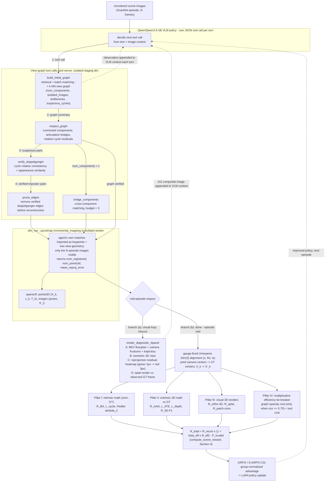
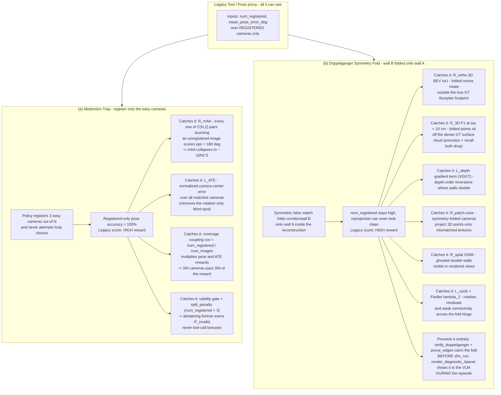
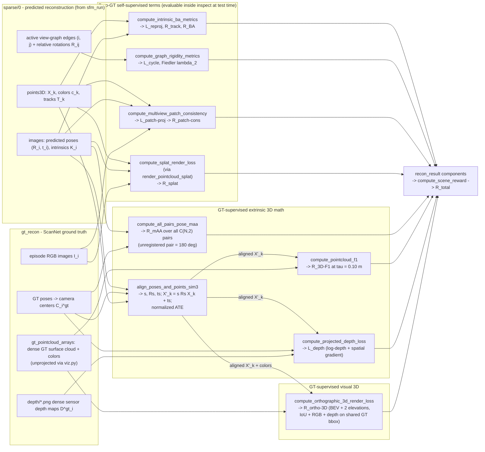
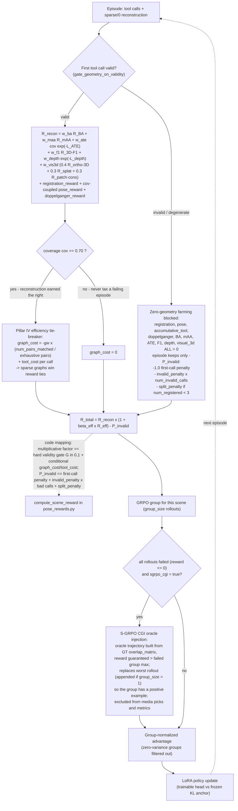

# 3D Reconstruction Losses & Visual Model Verification for Agentic SfM

> **How to read this document.** Section 1 gives the whole closed-loop process with two figures: the pipeline architecture and the anatomy of the two failure modes that the old proxy rewards could not see. Sections 2–3 specify every mathematical and visual 3D reconstruction loss, preceded by a dataflow diagram showing exactly which tensors from `sparse/0` and `gt_recon` feed which function in `reconstruction_loss.py`, and closed by a summary table mapping every loss to the physical artifact it measures. Section 4 shows how the terms aggregate into `R_total` and how the multiplicative gating prevents reward farming. All Mermaid diagrams render natively on GitHub.

## 1. Motivation: Moving Beyond Tool-Call and Pose-Gauge Proxies

In Phase 1 and early Phase 2 (`configs/phase2_scene.yaml`, `configs/phase2_calder_8xh200.yaml`), episode rewards were dominated by tool-interaction shaping (`first_call_validity_reward = 0.5`, `accumulative_tool_reward`) and a single coarse pose scalar (`mean_pose_error_deg` over registered cameras only). Audits of job `8073061` / `8085187` (`docs/scene_eval_and_env_proposal.md`) exposed four failure modes:

1. **Tool-call reward dominance:** Syntax and validity bonuses accounted for ~40–50% of total episode reward, allowing policies to hill-climb tool formatting without improving 3D structure.
2. **Abstention and translation blindness:** Scoring geodesic rotation error only on *registered* images rewards registering an easy 3-camera subset, and ignores camera center translation errors ($\text{ATE}$) after $\mathrm{Sim}(3)$ alignment.
3. **Unused 3D geometry and RGB-D ground truth:** COLMAP's triangulated 3D point cloud $\mathcal{P} = \{(X_k, c_k, \mathcal{T}_k)\}$ (`sparse/0`) and ScanNet's dense RGB-D sensor depth maps (`depth/*.png`) were never used in the reward.
4. **No visual feedback from the 3D model:** When a visual doppelganger (symmetry fold) slips into the view graph, two walls or corridors fold on top of each other. Camera count stays high, yet the 3D model is visibly broken (ghosted walls, out-of-footprint rooms, scrambled reprojections).

This document specifies the **Mathematical + Visual 3D Reconstruction Loss** stack implemented in `src/agentic_sfm/rewards/reconstruction_loss.py` and wired into `pose_rewards.py` and `scene_episode.py`.

### 1.1 The Whole Process at a Glance

The diagram below is the full closed loop the agent lives in. The `Qwen/Qwen3.5-2B` VLM policy emits one JSON tool call per turn; view-graph tools (`build_initial_graph`, `inspect_graph`, `verify_doppelganger`, `prune_edges`, `bridge_components`) shape the match graph; `sfm_run` runs `pycolmap`'s incremental mapper on the agent's *own* matches in an isolated worker; then two feedback branches close the loop:

- **Branch (a) — mid-episode visual loop closure:** `inspect` triggers `render_diagnostic_4panel`, whose BEV floorplan / isometric 3D / reprojection heatmap / splat-vs-GT composite is appended back into the VLM's image context, so the policy can *see* a symmetry fold before committing.
- **Branch (b) — episode-end 4-pillar reconstruction reward:** a gauge-fixed Umeyama $\mathrm{Sim}(3)$ alignment feeds Pillar I (intrinsic math, zero-GT), Pillar II (extrinsic 3D math vs GT), Pillar III (visual 3D renders), and Pillar IV (multiplicative efficiency tie-breaker), whose weighted sum drives the GRPO / S-GRPO CGI group advantage update.

*Figure 1 — End-to-end Agentic SfM pipeline architecture. Everything left of `sfm_run` is policy-controllable behavior (which pairs to match, which edges to prune, which matcher to route to); everything right of it is the verifiable 3D consequence of those decisions. The two feedback edges — the dashed 4-panel image into VLM context (branch a) and the 4-pillar reward into the policy update (branch b) — are the reason the policy can no longer hill-climb tool formatting while the 3D model silently breaks.*

### 1.2 Anatomy of the Two Classic Failure Modes

The legacy proxy (`registration_reward + pose_reward` on *registered-only* cameras) can be farmed in two qualitatively different ways. The side-by-side diagram below shows, for each farming strategy, what the legacy score reports and exactly which mathematical and visual loss terms catch it.

**Why the legacy proxy is blind:** (a) is invisible because the proxy conditions on the *registered subset* — the agent controls the conditioning set, so it defines away its own error. (b) is invisible because `num_registered` and mean reprojection error are both *topological / local* statistics — a global metric flip (reflection/rotation of one subgraph onto another) preserves both. Every catching term in the diagram is either **all-pairs** (closes the conditioning loophole) or **metric / rendered against GT geometry** (closes the topological loophole).

---

## 2. Pillar I: Mathematical 3D Reconstruction Losses

The flowchart below traces the **exact data tensors** flowing out of the predicted reconstruction (`sparse/0`) and the ground truth (`gt_recon`) into each function of `src/agentic_sfm/rewards/reconstruction_loss.py`. It covers both this section (Pillar I + Pillar II math) and Section 3 (visual losses) — refer back to it as each term is introduced.

*Dataflow note:* only `align_poses_and_points_sim3` and the all-pairs mAA touch GT poses; the four self-supervised terms (`R_BA`, `L_cycle`/`lambda_2`, `R_patch-cons`, `R_splat`) run on the *predicted* reconstruction alone and are the only terms available inside `inspect` at test time, where no GT exists.

### 2.1 Intrinsic Bundle & View-Graph Rigidity (Zero-GT, Self-Supervised)

These terms require **no ground-truth poses or depth maps**. They can be evaluated both in the RL reward and at test time inside `inspect`.

1. **Track-Conditioned Robust Bundle Adjustment Loss ($\mathcal{L}_{\text{BA}}, \mathcal{R}_{\text{BA}}$)**
   A 2-view track has zero redundancy—any two non-parallel rays triangulate. Multi-view geometric rigidity only emerges when tracks span $|\mathcal{T}_k| \ge 3$ views with well-conditioned triangulation angles:
   $$\mathcal{L}_{\text{reproj}} = \frac{1}{|\mathcal{P}|} \sum_{X_k \in \mathcal{P}} \rho_{\text{Huber}}\!\left(\frac{e_k}{\sigma_{\text{px}}}\right), \qquad \mathcal{R}_{\text{track}} = \operatorname{clip}\!\left(\frac{\bar{\ell}_{\mathcal{T}} - 2}{4},\, 0,\, 1\right) \cdot \frac{|\{X_k \in \mathcal{P} : |\mathcal{T}_k| \ge 3\}|}{\max(|\mathcal{P}|, 1)}$$
   $$\mathcal{R}_{\text{BA}} = \exp\!\left(-\frac{\mathcal{L}_{\text{reproj}}}{2.0}\right) \cdot \mathcal{R}_{\text{track}}$$

2. **View-Graph Cycle Consistency & Algebraic Connectivity ($\mathcal{L}_{\text{cycle}}, \lambda_2$)**
   - **3-Cycle Rotation Residual:** Over all 3-cycles $(i,j,k) \in \mathcal{C}_3$ in the active view graph:
     $$\mathcal{L}_{\text{cycle}} = \frac{1}{|\mathcal{C}_3|} \sum_{(i,j,k) \in \mathcal{C}_3} \arccos\!\left(\frac{\operatorname{tr}(R_{ki} R_{jk} R_{ij}) - 1}{2}\right)$$
   - **Fiedler Value $\lambda_2(\mathcal{L}_{\text{norm}})$:** The second-smallest eigenvalue of the symmetrically normalized Laplacian $\mathcal{L}_{\text{norm}} = I - D^{-1/2} A D^{-1/2}$ bounds the Cramér–Rao variance of rotation averaging and detects articulated hinge bridges ($\lambda_2 \to 0$).

### 2.2 Extrinsic 3D Metric Losses (Against GT Poses, Depth Maps, & 3D Clouds)

Let $(s, R_s, t_s)$ be the gauge-fixed Umeyama $\mathrm{Sim}(3)$ alignment from predicted camera centers $\{\hat{C}_i\}$ to ground-truth camera centers $\{C_i^{\text{gt}}\}$, mapping reconstructed 3D points to metric world coordinates $X'_k = s R_s X_k + t_s$.

1. **All-Pairs Relative Pose mAA + Normalized Camera ATE ($\mathcal{R}_{\text{cam}}$)**
   - **All-pairs IMC mAA:** Evaluated across all $\binom{N}{2}$ image pairs in the episode. Any pair involving an unregistered image receives $\epsilon_{ij} = 180^\circ$, closing the abstention loophole:
     $$\mathcal{R}_{\text{mAA}} = \frac{1}{\binom{N}{2}} \sum_{i < j} \frac{1}{3} \sum_{\tau \in \{5^\circ, 10^\circ, 20^\circ\}} \mathbb{1}\!\left[\max(\epsilon^{(R)}_{ij}, \epsilon^{(t)}_{ij}) < \tau\right]$$
   - **Normalized Absolute Trajectory Error ($\mathcal{L}_{\text{ATE}}$):**
     $$\mathcal{L}_{\text{ATE}} = \frac{1}{|M|} \sum_{i \in M} \rho_{\text{Huber}}\!\left(\frac{\|s R_s \hat{C}_i + t_s - C_i^{\text{gt}}\|_2}{\max(\operatorname{diam}(\{C^{\text{gt}}\}), 10^{-3})}\right)$$

2. **Projected 3D-Point-to-Sensor-Depth + Gradient Loss ($\mathcal{L}_{\text{depth}}$)**
   For each triangulated 3D point $X'_k$ projected into registered camera $i$ with GT sensor depth $D^{\text{gt}}_i(u_{ik}) > 0$:
   $$\mathcal{L}_{\text{depth}} = \frac{1}{|\mathcal{O}|}\sum_{(i,k)\in\mathcal{O}} \left|\log \frac{\hat{z}_{ik}}{D^{\text{gt}}_i(u_{ik})}\right|_1 + \lambda_{\nabla} \frac{1}{|\mathcal{N}|}\sum_{(k,k')\in\mathcal{N}_i} \left|(\hat{z}_{ik} - \hat{z}_{ik'}) - (D^{\text{gt}}_i(u_{ik}) - D^{\text{gt}}_i(u_{ik'}))\right|$$
   Following VGGT (CVPR 2025, arXiv:2503.11651), the spatial gradient term $\lambda_{\nabla}$ penalizes depth-order inversions caused by wall-doubling.

3. **Bidirectional Truncated Chamfer & Voxel-Normalized 3D F-Score ($\mathcal{R}_{\text{3D-F1}}$)**
   Comparing $\mathcal{P}'_{\text{pred}} = \{X'_k\}$ against the voxel-downsampled dense GT surface cloud $\mathcal{V}_{\text{gt}}$ (unprojected from ScanNet `depth/*.png` + `pose/*.txt` via `viz.py:gt_pointcloud_arrays`):
   $$P@\tau = \frac{1}{|\mathcal{P}'_{\text{pred}}|}\sum_{x \in \mathcal{P}'_{\text{pred}}} \mathbb{1}\!\left[\min_{y \in \mathcal{V}_{\text{gt}}} \|x - y\|_2 < \tau\right], \qquad R@\tau = \frac{1}{|\mathcal{V}_{\text{gt}}|}\sum_{y \in \mathcal{V}_{\text{gt}}} \mathbb{1}\!\left[\min_{x \in \mathcal{P}'_{\text{pred}}} \|x - y\|_2 < \tau\right]$$
   $$\mathcal{R}_{\text{3D-F1}} = \frac{2 \, P@\tau \, R@\tau}{P@\tau + R@\tau + \epsilon} \qquad (\tau = 0.10\text{ m})$$

---

## 3. Pillar II: Visual Reconstruction Losses from the 3D Model

Where Pillar I judges the reconstruction through *numbers* (residuals, errors, distances), the visual losses judge it through *renders* — what a human (or a VLM) would see looking at the 3D model. The demo figure below contrasts the two views of the same reconstruction failure.

*Figure 2 — Mathematical vs. visual losses on the same failure. The math terms quantify the fold after the fact (mAA and F-score drop, depth gradients invert); the visual terms make it *perceptible* — the BEV floorplan shows a room outside the footprint, the splat render shows ghosted walls, the patch-consistency map lights up mismatched textures. Together they close the loop: the same renders that drive $\mathcal{R}_{\text{ortho-3D}}$, $\mathcal{R}_{\text{splat}}$, and $\mathcal{R}_{\text{patch-cons}}$ also feed the VLM's context via `render_diagnostic_4panel`.*

### 3.1 Multi-View Patch Photometric & Feature-Metric Reprojection Consistency ($\mathcal{R}_{\text{patch-cons}}$)
*(Self-supervised — requires zero GT poses or depth)*

Each triangulated 3D point $X_k \in \mathcal{P}$ projects to $\hat{u}_{ik} = \pi(K_i, \hat{R}_i X_k + \hat{t}_i)$ across its observing views $i \in \mathcal{T}_k$. Sampling a local $p \times p$ RGB patch $W_i(\hat{u}_{ik})$ around each projection, we measure zero-mean normalized cross-correlation (ZNCC) and L1 color consistency against the track centroid patch $\bar{W}_k$:
$$\mathcal{L}_{\text{patch-proj}} = \frac{1}{|\mathcal{P}|}\sum_{X_k \in \mathcal{P}} \frac{1}{|\mathcal{T}_k|} \sum_{i \in \mathcal{T}_k} \left[ 0.5\big(1 - \operatorname{ZNCC}(W_i(\hat{u}_{ik}), \bar{W}_k)\big) + 0.5\,\|W_i(\hat{u}_{ik}) - \bar{W}_k\|_1 \right]$$
When a symmetry-folded camera is registered at a wrong pose, 3D points project onto mismatched textures, spiking $\mathcal{L}_{\text{patch-proj}}$.

### 3.2 Differentiable Soft-Point / Gaussian Splatting Novel-View Synthesis ($\mathcal{R}_{\text{splat}}$)

Given colored 3D points $\mathcal{P} = \{(X_k, c_k)\}$ with k-NN adaptive splat radius $\sigma_k$, we render the 3D point cloud into registered or held-out camera views $(K_i, \hat{R}_i, \hat{t}_i)$ using front-to-back $\alpha$-compositing:
$$\hat{C}_i(u) = \sum_{m=1}^{K} c_m \alpha_m(u) \prod_{l < m} (1 - \alpha_l(u)), \qquad \hat{O}_i(u) = 1 - \prod_{m=1}^{K} (1 - \alpha_m(u))$$
Evaluating on the valid splat support mask $M_i = \mathbb{1}[\hat{O}_i > 0.1]$:
$$\mathcal{R}_{\text{splat}} = \frac{1}{|V|}\sum_{i \in V} \Big( 0.6\,\operatorname{SSIM}_{M_i}(\hat{C}_i, I_i) + 0.4\,\big(1 - \|\hat{C}_i - I_i\|_{1, M_i}\big) \Big)$$

### 3.3 Canonical 3-View Orthographic 3D Model Render Loss ($\mathcal{R}_{\text{ortho-3D}}$)

Both $\mathcal{P}'_{\text{pred}}$ and $\mathcal{P}_{\text{gt}}$ are rendered from three canonical orthographic cameras sharing the GT bounding box:
- **Top-Down BEV Floorplan ($X$-$Y$)**
- **Front Elevation ($X$-$Z$)**
- **Side Elevation ($Y$-$Z$)**

For each view $v \in \{\text{BEV}, \text{Front}, \text{Side}\}$, dilated occupancy $O_v$, normalized depth $Z_v$, and color $RGB_v$ grids are rasterized:
$$\mathcal{R}_{\text{ortho-3D}} = \frac{1}{3}\sum_{v} \Big[ 0.45\,\operatorname{IoU}\!\big(O^{\text{pred}}_v, O^{\text{gt}}_v\big) + 0.30\,\big(1 - \|RGB^{\text{pred}}_v - RGB^{\text{gt}}_v\|_{1, O^{\text{pred}}_v \wedge O^{\text{gt}}_v}\big) + 0.25\,\big(1 - |Z^{\text{pred}}_v - Z^{\text{gt}}_v|_{1, O^{\text{pred}}_v \wedge O^{\text{gt}}_v}\big) \Big]$$
Symmetry folding (doppelgangers) rotates a corridor or wall outside the true room footprint in the BEV floorplan, immediately dropping $\operatorname{IoU}(O^{\text{pred}}_{\text{BEV}}, O^{\text{gt}}_{\text{BEV}})$.

### 3.4 Closing the Visual Loop: 4-Panel Diagnostic Render (`render_diagnostic_4panel`)

To give `Qwen3.5-2B` direct visual perception of the 3D model it built, `render_diagnostic_4panel` renders a single $2 \times 2$ composite figure:
1. **Panel A (Top-Down BEV Floorplan):** Orthographic $X$-$Y$ projection of colored 3D points + camera frustums + trajectory polyline.
2. **Panel B (Isometric 3D View):** 3D point cloud + frustum cones.
3. **Panel C (3D Reprojection Residual Heatmap):** 3D points colored by reprojection error (green $\le 1\text{ px} \to$ red $\ge 3\text{ px}$) to highlight floaters and folded surfaces.
4. **Panel D (Splat-Rendered Camera View vs. Ground-Truth Frame):** Side-by-side / overlay of the splat-rendered 3D model from a registered camera against the observed RGB image.

### 3.5 Visual Intuition Summary Table

| Loss / term | What physical / visual artifact it measures | What failure mode it kills | Formula (core) | Function in `reconstruction_loss.py` |
|---|---|---|---|---|
| $\mathcal{R}_{\text{BA}}$ (track-conditioned BA) | Pixel reprojection residuals + multi-view track redundancy of the triangulated cloud | Floaters from 2-view-only triangulation; tool-formatting hill-climbs that never build rigid geometry | $\exp(-\mathcal{L}_{\text{reproj}}/2) \cdot \mathcal{R}_{\text{track}}$ | `compute_intrinsic_ba_metrics` |
| $\mathcal{L}_{\text{cycle}}$, $\lambda_2$ (graph rigidity) | Loop-closure rotation error over 3-cycles + algebraic connectivity of the match graph | Hinge bridges between rooms, disconnected components, doppelganger-rotated subgraphs | $\arccos\!\big(\frac{\operatorname{tr}(R_{ki} R_{jk} R_{ij})-1}{2}\big)$; $\lambda_2(\mathcal{L}_{\text{norm}})$ | `compute_graph_rigidity_metrics` |
| $\mathcal{R}_{\text{mAA}}$ (all-pairs pose mAA) | Relative rotation + translation accuracy across all $\binom{N}{2}$ pairs | **Abstention trap** — registering only an easy 3-camera subset | $\text{mAA}@\{5^\circ, 10^\circ, 20^\circ\}$, unregistered pair $= 180^\circ$ | `compute_all_pairs_pose_maa` |
| Umeyama $\mathrm{Sim}(3)$ alignment | The gauge fix $(s, R_s, t_s)$ putting the reconstruction into metric GT coordinates | Makes every metric term well-posed; kills scale/rotation/translation-gauge cheating | $X'_k = s R_s X_k + t_s$ | `align_poses_and_points_sim3` |
| $\mathcal{L}_{\text{ATE}}$ (normalized ATE) | Camera-center trajectory error after $\mathrm{Sim}(3)$, normalized by GT scene diameter | Translation-blind, rotation-only scoring | $\rho_{\text{Huber}}\!\big(\frac{\|s R_s \hat{C}_i + t_s - C_i^{\text{gt}}\|_2}{\operatorname{diam}}\big)$ | `align_poses_and_points_sim3` |
| $\mathcal{R}_{\text{3D-F1}}$ (3D F-score) | Bidirectional surface coverage of the pred cloud vs. dense GT cloud at $\tau = 10$ cm | Folded/duplicated geometry missing or exceeding the real surface | $2P@\tau\, R@\tau / (P@\tau + R@\tau + \epsilon)$ | `compute_pointcloud_f1` |
| $\mathcal{L}_{\text{depth}}$ (projected depth) | Log-depth of pred 3D points vs. ScanNet sensor depth + local depth-order gradients | Depth-order inversions from wall-doubling (VGGT gradient term) | $\left\|\log \frac{\hat{z}}{D^{\text{gt}}}\right\|_1 + \lambda_\nabla \|\Delta\hat{z} - \Delta D^{\text{gt}}\|_1$ | `compute_projected_depth_loss` |
| $\mathcal{R}_{\text{ortho-3D}}$ (orthographic renders) | BEV floorplan + front/side elevation occupancy/depth/color agreement with GT | **Doppelganger symmetry fold** rotating rooms out of the true footprint | $0.45\,\operatorname{IoU} + 0.30\,(1 - RGB_{L1}) + 0.25\,(1 - Z_{L1})$ per view | `compute_orthographic_3d_render_loss` |
| $\mathcal{R}_{\text{splat}}$ (splat render) | How faithfully a splat-render of the colored cloud reproduces real views | Ghost walls / holes visible in rendered novel views | $0.6\,\operatorname{SSIM}_{M_i} + 0.4\,(1 - \|\hat{C}_i - I_i\|_{1, M_i})$ | `compute_splat_render_loss` |
| $\mathcal{R}_{\text{patch-cons}}$ (patch consistency) | Photometric self-consistency of each track's projections (ZNCC + L1) | Symmetry-folded cameras projecting points onto mismatched textures | $0.5(1 - \operatorname{ZNCC}) + 0.5\|W_i - \bar{W}_k\|_1$ | `compute_multiview_patch_consistency` |
| 4-panel diagnostic *(not a loss)* | BEV floorplan, isometric 3D, reprojection heatmap, splat-vs-GT — rendered for the VLM's own eyes | Lets the policy *see* a symmetry fold mid-episode, before the reward punishes it | renders only | `render_diagnostic_4panel` |

---

## 4. Unified Reward Composition & Pre-Registered Ablation Protocol

As a design abstraction, the episode reward is **multiplicative**, not a flat sum:

$$R_{\text{total}} = R_{\text{recon}} \times \big(1 + \beta_{\text{eff}} \cdot R_{\text{eff}}\big) - P_{\text{invalid}}$$

The point of the multiplicative form: **a zero-geometry episode cannot farm tool-call rewards.** In the implementation (`compute_scene_reward` in `pose_rewards.py`) each factor is realized concretely:

- **$R_{\text{recon}}$** is the weighted sum of the geometry terms listed in §4.1 — every one of them is $0$ when no reconstruction exists, and several (pose, ATE) are additionally multiplied by coverage $\text{cov} = \text{num\_registered}/\text{num\_images}$.
- **The multiplicative gate** is a *hard* first-call validity gate (`gate_geometry_on_validity`): if the first tool call was rejected/degenerate, *every* geometry term **and** `accumulative_tool_reward` are zeroed — the episode keeps only the $-P_{\text{invalid}}$ penalties. This kills the "least-bad-wins" trap where a degenerate trajectory outscores its all-failed group by a formatting bonus.
- **$\beta_{\text{eff}} \cdot R_{\text{eff}}$** is realized as the *conditional* efficiency tax: `graph_cost` = $-w_g \cdot (\text{matched pairs} / \binom{N}{2})$ is levied **only when** $\text{cov} \ge 0.70$ (sparsity is rewarded for tying episodes that already reconstructed, never for punishing failure), plus `tool_cost` per call. Among two episodes with equal $R_{\text{recon}}$, the sparser, cheaper view graph wins the tie.
- **$P_{\text{invalid}}$** = `first_call_invalid_penalty` ($1.0$) + `invalid_penalty` $\times$ `num_invalid_calls` + `split_penalty` when $\text{num\_registered} < 3$.

**S-GRPO CGI oracle injection** (per `scripts/run_scene_grpo.py`): the trigger is `sgrpo_cgi: true` **and** every rollout in the scene's group failed (reward $\le 0$). The oracle episode is constructed from the GT `overlap_matrix` (not the policy's own beliefs), its reward is guaranteed above the failed group's max, and it replaces the worst rollout (or is appended when `group_size = 1`, so the zero-variance filter doesn't drop the group). Oracle trajectories are synthetic, so they are excluded from media picks and metrics — they exist purely to give the advantage estimator a positive sample when the group would otherwise carry no learning signal.

*Figure 3 — Loss response curves. Each curve answers one question: if I inject failure magnitude $x$ into an otherwise good reconstruction, how much reward does this term remove? The all-pairs and surface-coverage terms ($\mathcal{R}_{\text{mAA}}$, $\mathcal{R}_{\text{3D-F1}}$, BEV IoU) respond steeply and monotonically — good gradient signal everywhere. The $\exp(-\mathcal{L})$ shaping terms saturate at both ends — deliberately, so a nearly-perfect reconstruction isn't over-rewarded for cosmetics and a catastrophic one is floored at $0$, not pushed negative. The validity gate is the discontinuity: below "a real reconstruction exists," the whole $R_{\text{recon}}$ branch is zeroed and only $-P_{\text{invalid}}$ remains.*

### 4.1 Composite Scene Reward (`compute_scene_reward`)

When `use_reconstruction_loss: true` is enabled in the reward config (or when `recon_result` carries the injected reconstruction loss components), `compute_scene_reward` adds:
- `intrinsic_ba_reward`: $w_{\text{ba}} \cdot \mathcal{R}_{\text{BA}}$
- `all_pairs_maa_reward`: $w_{\text{maa}} \cdot \mathcal{R}_{\text{mAA}}$
- `ate_reward`: $w_{\text{ate}} \cdot \text{cov} \cdot \exp(-\mathcal{L}_{\text{ATE}})$
- `pointcloud_f1_reward`: $w_{\text{f1}} \cdot \mathcal{R}_{\text{3D-F1}}$
- `depth_consistency_reward`: $w_{\text{depth}} \cdot \exp(-\mathcal{L}_{\text{depth}})$
- `visual_3d_reward`: $w_{\text{vis3d}} \cdot \big(0.4\,\mathcal{R}_{\text{ortho-3D}} + 0.3\,\mathcal{R}_{\text{splat}} + 0.3\,\mathcal{R}_{\text{patch-cons}}\big)$

All new weights default to `0.0` when not specified so existing tests and configs remain 100% backward-compatible.

### 4.2 Pre-Registered Ablation Matrix (Calder 8×H200)

| Arm | Description | Active Reward Terms | Primary Metric (Frozen 30-Scene ScanNet) |
|---|---|---|---|
| **R0** | Legacy baseline | `registration_reward + pose_reward + first_call_validity (0.5)` | All-pairs mAA & 3D $\text{F}_1@10\text{cm}$ |
| **R1** | Intrinsic + Extrinsic Math 3D Loss | R0 (`first_call_validity=0`) + $\mathcal{R}_{\text{BA}} + \mathcal{R}_{\text{mAA}} + \mathcal{R}_{\text{ATE}} + \mathcal{R}_{\text{3D-F1}} + \mathcal{R}_{\text{depth}}$ | All-pairs mAA & 3D $\text{F}_1@10\text{cm}$ |
| **R2** | Math + Visual 3D Reconstruction Loss | R1 + $\mathcal{R}_{\text{ortho-3D}} + \mathcal{R}_{\text{splat}} + \mathcal{R}_{\text{patch-cons}}$ | All-pairs mAA, 3D $\text{F}_1@10\text{cm}$, BEV IoU |
| **R3** | Visual Loop Closure | R2 + `render_diagnostic_4panel` returned on `inspect` | All-pairs mAA, doppelganger F1, BEV IoU |

---

## 5. Key References

- **DUSt3R** (CVPR 2024): https://arxiv.org/abs/2312.14132
- **MASt3R** (ECCV 2024): https://arxiv.org/abs/2406.09756
- **VGGT** (CVPR 2025): https://arxiv.org/abs/2503.11651
- **VGGSfM** (CVPR 2024): https://arxiv.org/abs/2312.04563
- **FlowMap** (2024): https://arxiv.org/abs/2404.15259
- **InstantSplat** (2024/2025): https://arxiv.org/abs/2403.20309
- **ACE0** (ECCV 2024): https://arxiv.org/abs/2404.14351
- **Doppelgangers** (ICCV 2023): https://arxiv.org/abs/2309.02420
- **Spectral SLAM Sparsification / Fiedler $\lambda_2$**: https://arxiv.org/abs/2203.13897
- **Rotation Averaging Strong Duality** (CVPR 2018): https://arxiv.org/abs/1705.01362
- **GPTEval3D** (CVPR 2024): https://arxiv.org/abs/2401.04092
